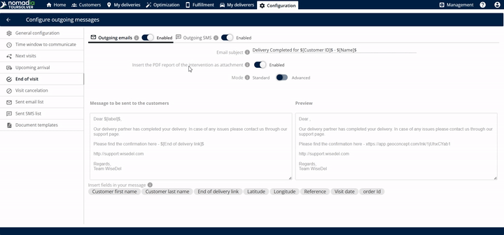
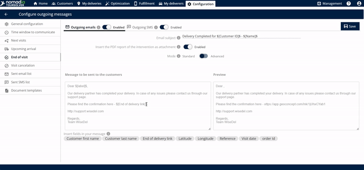
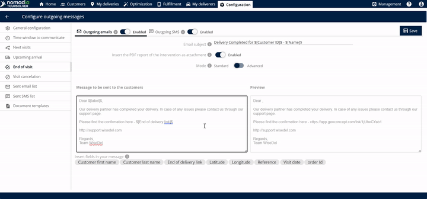
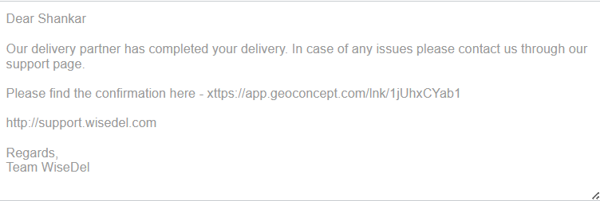

# Fine della visita

## 1. Introduzione

La funzione **Fine della visita** consente di automatizzare i messaggi di follow-up inviati al tuo cliente.

**Cos'è** la funzione **Fine della visita?** È il processo che avviene **una volta completata la consegna**. Al termine, il cliente riceve automaticamente un'e-mail con un file PDF allegato.

**La prova di consegna in PDF (PoD)** Questo PDF allegato funge da prova ufficiale di avvenuta consegna. Conferma dettagli essenziali per il cliente, tra cui:

* Il nome del cliente
* L'indirizzo del cliente
* Le firme raccolte durante la visita

## 2. Configurazione iniziale

Prima di inviare il primo messaggio, è necessario abilitare i canali di comunicazione di base.

1. **Accedi alle impostazioni Fine della visita:**
   * Clicca sull' **Fine della visita** opzione per accedere alla schermata di configurazione.

2. **Abilita i canali in uscita:**
   * Abilita le **e-mail in uscita** opzione

3. **Imposta l'oggetto dell'e-mail**

4. Attiva l'interruttore per inviare la PoD (prova di consegna) come file PDF

5. Clicca sul pulsante **Salva p**er applicare le modifiche al modello modificato.

## 3. Spiegazioni delle funzionalità con benefici

Questa funzionalità offre flessibilità e una consegna chiara della documentazione.

| Funzionalità                                    | Descrizione                                                                                                                                              |
| ----------------------------------------------- | -------------------------------------------------------------------------------------------------------------------------------------------------------- |
| **Link ETA**                                    | Un link contenente il tempo stimato di arrivo (ETA) viene creato automaticamente e inviato una volta avviata la consegna.                                |
| **Modifica dell'oggetto dell'e-mail**           | Puoi inserire e personalizzare **l'oggetto dell'e-mail** così i clienti capiscono immediatamente lo scopo del messaggio.                                 |
| **Modifica del corpo del messaggio**            | Puoi liberamente **modificare il messaggio** che verrà inviato ai tuoi clienti, permettendo un linguaggio personalizzato e dettagli importanti           |
| **Tag di personalizzazione ($)**                | Inserendo il **simbolo del dollaro** ($) vengono mostrate opzioni che puoi inserire e modificare direttamente nel corpo dell'e-mail, risparmiando tempo. |
| **Finestra di anteprima**                       | Prima di salvare, puoi vedere l' **anteprima** del messaggio esatto che sarà inviato, assicurandoti che appaia professionale e accurato.                 |
| **Tracciamento della posizione in tempo reale** | Il link permette al cliente di tracciare la posizione in tempo reale della consegna (o della risorsa).                                                   |
| **Email in uscita**                             | Opzione per abilitare l'invio del link ETA via e-mail.                                                                                                   |
| **SMS in uscita**                               | Opzione per abilitare l'invio del link ETA tramite messaggio di testo.                                                                                   |

## 4. Personalizzazione e revisione dell'oggetto

Segui questi passaggi per personalizzare il corpo del messaggio e confermare l'aspetto finale dell'e-mail.

1. **Seleziona la modalità di comunicazione:**
   * Cambia la **modalità di comunicazione** in **standard** o **avanzata** in base al livello di dettaglio richiesto.

2. **Visualizza il messaggio corrente:**
   * Guarda la sezione che mostra il **messaggio da inviare al cliente**.
3. **Modifica il corpo del messaggio (Opzionale):**
   * Se devi adattare il contenuto, puoi **modificare questo corpo dell'e-mail**.

4.  **Anteprima dell'e-mail finale:**

    * Rivedi l'**Oggetto:** Controlla l'area **anteprima** per vedere esattamente come apparirà l'e-mail finale al cliente. Questa è la tua occasione per rivedere il messaggio prima di salvare
    * **Inserisci informazioni personalizzate (Opzionale)** Per includere informazioni dinamiche (come il nome del cliente o dettagli specifici dell'appuntamento), inserisci il **simbolo del dollaro** ($). Questo mostrerà opzioni che puoi usare per modificare il corpo dell'e-mail.

    > 💡 **Suggerimento:** L'uso di tag di personalizzazione rende il messaggio più diretto e professionale.

5. **Salva la configurazione:**
   * Una volta soddisfatto delle impostazioni e dell'anteprima, fai clic su **Salva**.

6. Il cliente riceverà la seguente e-mail

<figure><figcaption></figcaption></figure>

***

## 5. Suggerimenti per la produttività

Usa questi suggerimenti per massimizzare l'efficacia e la chiarezza delle comunicazioni con i clienti.

* **💡 Controlla in anticipo il contenuto della PoD:** Ricorda che l'allegato PDF è cruciale. Puoi ricordarti che il cliente verificherà il proprio nome, indirizzo e le firme all'interno dell'allegato.
* **💡 Usa spesso l'anteprima:** Prima di salvare le modifiche, usa la funzione di anteprima per ricontrollare la formattazione e assicurarti che il corpo del messaggio sia corretto. L'anteprima mostra esattamente ciò che il cliente vedrà.
* **💡 Verifica l'inclusione dell'allegato:** Assicurati sempre di aver abilitato l'opzione per **Inserire il rapporto PDF dell'intervento come allegato**. Questo garantisce che la necessaria prova di consegna sia inclusa.
