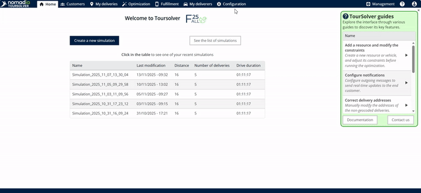
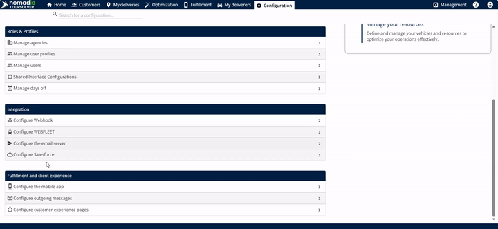
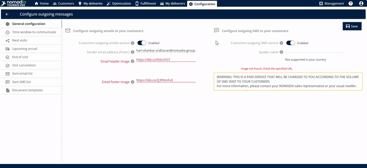
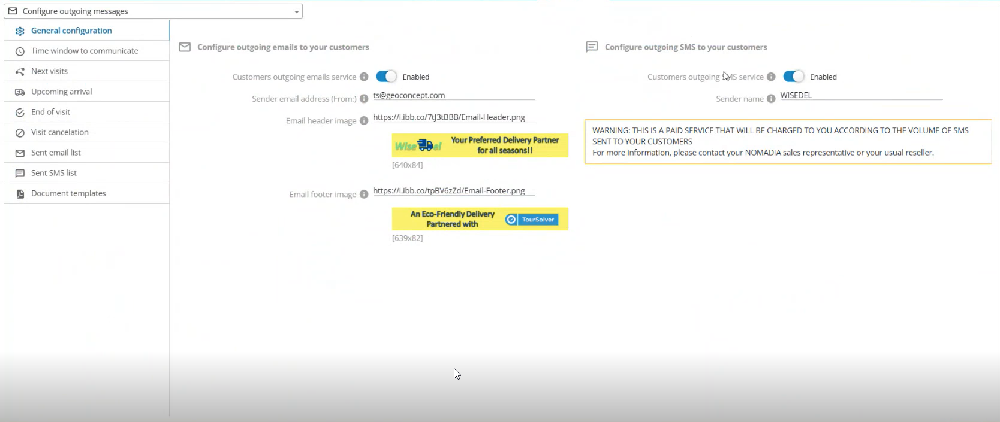
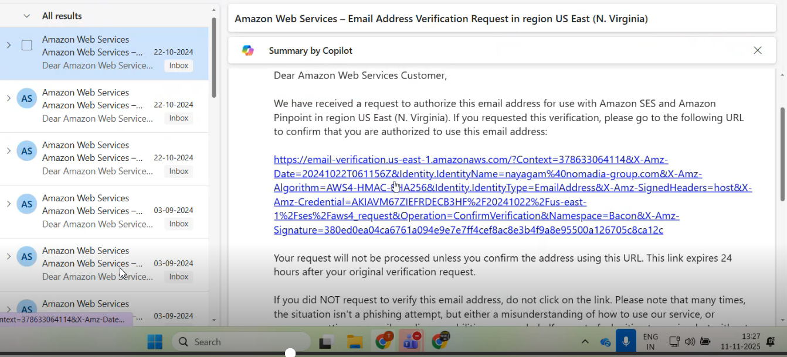
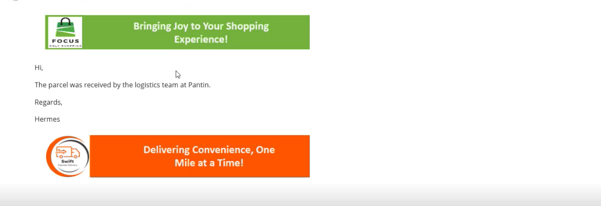

# Configurazione generale

## 1. Introduzione

La funzione **Configurazione Generale Comunicazione Cliente** ti permette di abilitare, disabilitare e personalizzare le impostazioni fondamentali per l'invio di messaggi in uscita ai tuoi clienti. Hai il potere di controllare sia il **servizio e-mail in uscita per i clienti** e il **servizio SMS in uscita per i clienti**.

## 2. Configurazione Iniziale

Per iniziare a configurare le preferenze di comunicazione con i clienti, è necessario andare alla schermata di Configurazione Generale:

1. **Inizia dalla Homepage:** Vai alla **pagina principale**.

2. Fai clic su **Configura Messaggi in Uscita**

3. **Apri Configurazione Generale:** Arriverai alla schermata di **Configurazione generale**.

***

## 3. Spiegazione delle funzionalità e vantaggi

Questa area di configurazione gestisce due potenti modi in cui puoi raggiungere i tuoi clienti:

| Funzionalità                                | Descrizione e Utilità                                                                                                                                                                                                  |
| ------------------------------------------- | ---------------------------------------------------------------------------------------------------------------------------------------------------------------------------------------------------------------------- |
| **Servizio E-mail in Uscita per i Clienti** | Consente al sistema di inviare e-mail ai clienti per conto tuo. **Vantaggio:** Puoi personalizzare l'aspetto delle tue e-mail utilizzando elementi di branding come le immagini dell'intestazione e del piè di pagina. |
| **Servizio SMS in Uscita per i Clienti**    | Consente al sistema di inviare messaggi di testo (SMS) direttamente ai clienti. **Vantaggio:** Fornisce una comunicazione rapida e diretta per aggiornamenti urgenti o importanti.                                     |

**Considerazioni Chiave per gli SMS:**

* ⚠️ **Attenzione: Servizio a Pagamento** – L'attivazione del servizio SMS in uscita è un **servizio a pagamento**. Ti verrà addebitato in base al volume di messaggi SMS inviati ai tuoi clienti.
* **Limite di Caratteri** – Ogni messaggio SMS standard deve essere di **160 caratteri**. Se il tuo messaggio supera i 160 caratteri, il sistema automaticamente **dividerà l'SMS in due messaggi SMS**.

***

## 4. Configurazione della Comunicazione con i Clienti

Questa sezione ti guida attraverso il processo di impostazione e attivazione sia dei canali di comunicazione e-mail che SMS.

#### Abilitazione e Personalizzazione dell'E-mail in Uscita

Usa questi passaggi per attivare la comunicazione via e-mail e assicurarti che le tue e-mail abbiano un aspetto professionale con le immagini del tuo marchio.

1. **Abilita il Servizio E-mail:** Una volta nella schermata di Configurazione Generale, abilita il **servizio e-mail in uscita per i clienti**.
2. **Inserisci l'E-mail del Mittente:** Inserisci il **indirizzo e-mail del mittente**.

3. **Aggiungi Link Immagine Intestazione/Piè di Pagina (Opzionale):** Inserisci il **link immagine intestazione/piè di pagina**. Questo spesso contiene informazioni legali o dettagli di contatto. 💡 **Suggerimento:** Se non inserisci un link all'immagine dell'intestazione e un link all'immagine del piè di pagina, l'e-mail risultante verrà inviata senza questi elementi visivi.

#### Abilitazione SMS in Uscita

1. **Abilita il Servizio SMS:** Individua e abilita il **servizio SMS in uscita per i clienti**.
   * **Contesto:** Se abiliti questo servizio, i tuoi clienti inizieranno a ricevere messaggi SMS dal sistema.

#### Salvataggio delle Modifiche e Validazione della tua E-mail

Per attivare la configurazione della comunicazione, devi salvare le modifiche e completare un importante passaggio di convalida.

2. **Ricevi l'E-mail di Validazione:** Dopo aver cliccato **salva**, il sistema invierà automaticamente un'e-mail all'indirizzo del mittente che hai fornito. Questa email include un **link per convalidare l'e-mail**.

<figure><figcaption></figcaption></figure>

3. **Clicca il Link di Validazione:** Vai nella tua casella di posta, apri l'e-mail di validazione e clicca sul link fornito.

<figure><figcaption></figcaption></figure>

4. **Attivazione Confermata:** Una volta cliccato il link, il sistema sarà autorizzato a inviare e-mail ai clienti **per conto tuo**.

<figure><figcaption></figcaption></figure>

***

## 5. Consigli di Produttività

Ecco alcuni suggerimenti per massimizzare l'efficacia quando usi le impostazioni di Configurazione Generale:

* 💡 **Branding Coerente:** Cerca sempre di inserire sia il **link immagine intestazione** e il **link immagine piè di pagina**. L'uso di questi link aiuta a mantenere un branding professionale per tutte le e-mail inviate ai tuoi clienti.
* ⚠️ **Controlla il Numero di Caratteri:** L'invio di SMS è un servizio in abbonamento a pagamento e quando invii messaggi SMS, ricorda il **limite di 160 caratteri**. Mantieni i tuoi messaggi concisi per evitare che vengano divisi in due messaggi separati, soggetti a pagamento.
* 💡 **Validazione Immediata:** Per garantire una consegna senza intoppi delle e-mail, completa il passaggio di convalida immediatamente dopo aver cliccato **salva**. Il link di validazione conferma che il sistema (TourSolver) ha il permesso di inviare messaggi utilizzando l'indirizzo mittente da te scelto.
