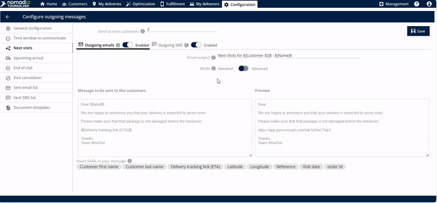
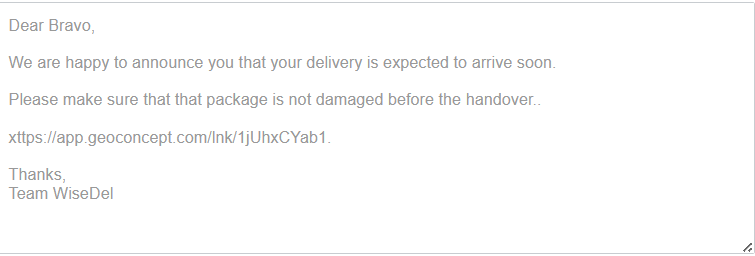

# Visite successive

## 1. Introduzione

La funzione **Visite successive** è progettata per automatizzare le notifiche, informando i tuoi prossimi clienti che sei in arrivo. Questo garantisce una comunicazione fluida e una migliore preparazione per il tuo arrivo.

Puoi scegliere esattamente quanti dei prossimi clienti riceveranno questo messaggio, personalizzare il contenuto e decidere se inviarlo via e-mail o SMS.

## 2. Configurazione Iniziale

Il tuo primo passo è definire come notificherai i tuoi prossimi clienti.

**Accedi alla funzione Visite successive:** Fai clic su **visite successive**.

**Definisci il numero target di clienti** Specifica il numero di prossimi clienti che vuoi notificare. Puoi scegliere di inviare una notifica al prossimo, ai prossimi due o ai prossimi tre clienti.

* Se inserisci **uno**, l'e-mail viene inviata al prossimo cliente.
* Se inserisci **due**, l'e-mail viene inviata ai prossimi due clienti.
* Se inserisci **tre** (o qualsiasi numero tu desideri), l'e-mail viene inviata a quel numero di clienti.

***

## 3. Spiegazione delle funzionalità con vantaggi

La forza di questo strumento risiede nella sua personalizzazione e nel meccanismo di attivazione.

| Funzionalità                                    | Descrizione                                                                                                                                              |
| ----------------------------------------------- | -------------------------------------------------------------------------------------------------------------------------------------------------------- |
| **Link ETA**                                    | Un link contenente l'ora stimata di arrivo (ETA) viene creato automaticamente e inviato una volta che la consegna è iniziata.                            |
| **Modifica dell'Oggetto E-mail**                | Puoi inserire e personalizzare il **oggetto dell'e-mail** così i clienti sanno immediatamente lo scopo del messaggio.                                    |
| **Modifica del Corpo del Messaggio**            | Puoi liberamente **modificare il messaggio** che verrà inviato ai tuoi clienti, consentendo un linguaggio personalizzato e dettagli importanti           |
| **Tag di Personalizzazione ($)**                | Inserendo il **simbolo del dollaro** ($) vengono mostrate opzioni che puoi inserire e modificare direttamente nel corpo dell'e-mail, risparmiando tempo. |
| **Finestra di Anteprima**                       | Prima di salvare, puoi vedere l' **anteprima** del messaggio esatto che sarà inviato, assicurandoti che appaia professionale e accurato.                 |
| **Tracciamento della Posizione in Tempo Reale** | Il link permette al cliente di tracciare la posizione in tempo reale della consegna (o della risorsa).                                                   |
| **Email in Uscita**                             | Opzione per abilitare l'invio del link ETA via e-mail.                                                                                                   |
| **SMS in Uscita**                               | Opzione per abilitare l'invio del link ETA tramite messaggio di testo.                                                                                   |

## 4. Personalizza e salva le impostazioni di comunicazione con il cliente

Questa attività garantisce che i tuoi prossimi clienti ricevano un messaggio su misura che li avvisa del tuo imminente arrivo.

1. **Inserisci l'oggetto dell'e-mail:** Trova il campo per l'oggetto dell'e-mail e inserisci un titolo chiaro e conciso.

2. **Modifica il contenuto del messaggio** Personalizza il corpo del messaggio che sarà inviato ai tuoi clienti.
3.  **Inserisci Informazioni Personalizzate (Opzionale)** Per includere informazioni dinamiche (come il nome di un cliente o dettagli specifici dell'appuntamento), inserisci il **simbolo del dollaro** ($). Questo mostrerà opzioni che puoi usare per modificare il corpo dell'e-mail.

    > 💡 **Suggerimento:** Usare i tag di personalizzazione rende il messaggio più diretto e professionale.

4. **Rivedi l'oggetto:** Controlla l' **anteprima** area per vedere esattamente come apparirà l'e-mail finale al cliente. Questa è la tua occasione per rivedere il messaggio prima di salvare.
5. **Salva le tue impostazioni** Una volta inserite e modificate tutte le informazioni necessarie, clicca su **salva**.

6. Il cliente riceverà la seguente e-mail.&#x20;

<figure><figcaption></figcaption></figure>

***

## 5. Consigli di Produttività

Ecco alcuni consigli per massimizzare l'efficacia della funzione di comunicazione Visite successive:\
1\. **Massimizza la personalizzazione:** Usa sempre il simbolo del dollaro ($) quando modifichi il corpo del    messaggio. Questo garantisce di utilizzare i campi disponibili per contenuti dinamici, creando comunicazioni professionali e dettagliate senza inserimento manuale ogni volta.
