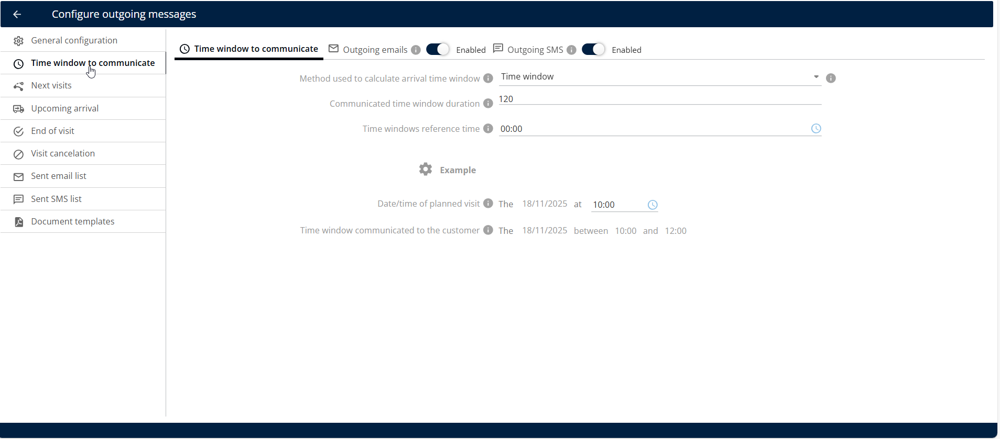
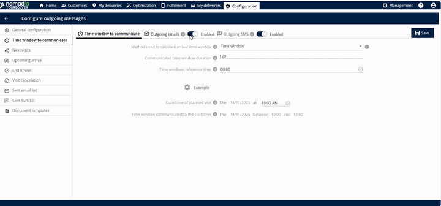
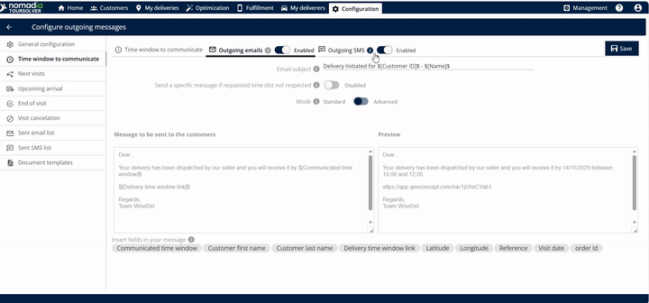
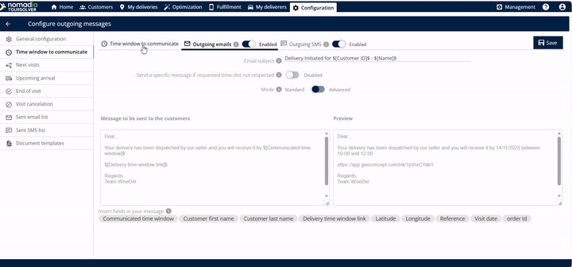
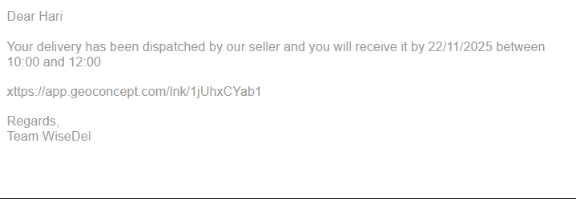

# Finestra temporale per comunicare

## 1. Introduzione

La funzionalità **Finestra temporale da comunicare**  ti consente di definire l'intervallo di tempo esatto comunicato al tuo cliente riguardo a una visita imminente. Questo calcola la finestra di arrivo e gestisce la comunicazione in uscita tramite e-mail e SMS.

## 2. Configurazione Iniziale

1. Fai clic su **Finestra temporale da comunicare**.

<figure><figcaption></figcaption></figure>

***

## 3. Spiegazione delle funzionalità e vantaggi

Questa funzionalità è potente perché ti permette di controllare esattamente come le informazioni di arrivo vengono calcolate e consegnate.

| Funzionalità                                    | Descrizione                                                                                                                                                       |
| ----------------------------------------------- | ----------------------------------------------------------------------------------------------------------------------------------------------------------------- |
| **Link ETA**                                    | Un link contenente l'ora stimata di arrivo (ETA) viene creato automaticamente e inviato una volta che la consegna è pianificata.                                  |
| **Modifica dell'Oggetto E-mail**                | Puoi inserire e personalizzare il **oggetto dell'e-mail** così i clienti sanno immediatamente lo scopo del messaggio.                                             |
| **Modifica del Corpo del Messaggio**            | Puoi liberamente **modificare il messaggio** che verrà inviato ai tuoi clienti, consentendo un linguaggio personalizzato e la condivisione di dettagli importanti |
| **Tag di Personalizzazione ($)**                | Inserendo il **simbolo del dollaro** ($) vengono mostrate opzioni che puoi inserire e modificare direttamente nel corpo dell'e-mail, risparmiando tempo.          |
| **Finestra di Anteprima**                       | Prima di salvare, puoi vedere l' **anteprima** del messaggio esatto che sarà inviato, assicurandoti che appaia professionale e accurato.                          |
| **Tracciamento della Posizione in Tempo Reale** | Il link permette al cliente di tracciare la posizione in tempo reale della visita (o del corriere).                                                               |
| **E-mail in Uscita**                            | Opzione per abilitare l'invio del link ETA via e-mail.                                                                                                            |
| **SMS in Uscita**                               | Opzione per abilitare l'invio del link ETA tramite messaggio di testo.                                                                                            |

## 4. Configurazione della finestra temporale di comunicazione al cliente e delle notifiche

Segui questi passaggi per definire la finestra temporale precisa e abilitare la comunicazione per la visita del cliente.

1. **Accedi alla funzionalità:** Fai clic su **Finestra temporale da comunicare**.
2. **Definisci il metodo di calcolo:**
   * Seleziona il metodo della finestra temporale che viene usato per calcolare la finestra di arrivo.

3. **Imposta la durata:**
   * Inserisci la durata della finestra temporale comunicata.

💡 Suggerimento: Inserire \*\*120 minuti\*\* comporterà una finestra di 2 ore comunicata al cliente (es. dalle 10:00 alle 12:00).

4\. **Seleziona il tempo di riferimento:**

5. **Inserisci i dettagli della visita programmata:**
   * Individua il campo **Data e ora della visita programmata**.

6. **Rivedi la finestra temporale calcolata:**
   * Il sistema mostrerà la **finestra temporale comunicata al cliente**.
   * Ad esempio, se imposti la durata a 2 ore, il sistema potrebbe calcolare la finestra dalle 10:00 alle 12:00.
7.  **Abilita la Comunicazione via E-mail:**

    * Puoi abilitare l'opzione **e-mail in uscita**.
    * Rivedi il messaggio che deve essere inviato al cliente sotto questa sezione.
    * **Inserisci Informazioni Personalizzate (Opzionale)** Per includere informazioni dinamiche (come il nome di un cliente o dettagli specifici dell'appuntamento), inserisci il **simbolo del dollaro** ($). Questo mostrerà opzioni che puoi usare per modificare il corpo dell'e-mail.

    &#x20;      💡 **Suggerimento:** L'uso dei tag di personalizzazione rende il messaggio più diretto e professionale

8.  **Abilita la Comunicazione via SMS (Opzionale):**

    * Puoi anche abilitare l'opzione **SMS in uscita**.
    * **Inserisci Informazioni Personalizzate (Opzionale)** Per includere informazioni dinamiche (come il nome di un cliente o dettagli specifici dell'appuntamento), inserisci il **simbolo del dollaro** ($). Questo mostrerà opzioni che puoi usare per modificare il corpo dell'e-mail.

    > 💡 **Suggerimento:** Usare i tag di personalizzazione rende il messaggio più diretto e professionale.

9. **Salva le Tue Impostazioni:**

10. Il cliente riceverà la seguente e-mail

<figure><figcaption></figcaption></figure>

## 5. Consigli di Produttività

Questi suggerimenti ti aiuteranno a lavorare in modo più efficiente e a garantire una comunicazione fluida con i tuoi clienti:

* **Usa la funzione di anteprima:** Usa sempre l'opzione **anteprima** disponibile sia per le e-mail in uscita sia per gli SMS in uscita. Questo ti aiuta a confermare esattamente ciò che il cliente vedrà prima di salvare le impostazioni, garantendo accuratezza e chiarezza.
* **Mantieni le durate chiare:** Quando imposti la **Durata della finestra temporale comunicata**, scegli incrementi comuni (come 60 minuti o 120 minuti) che siano facili da comprendere per i clienti. Una finestra chiara e definita previene confusione.
