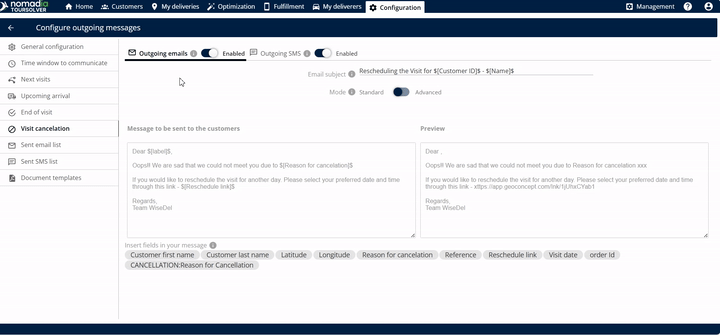
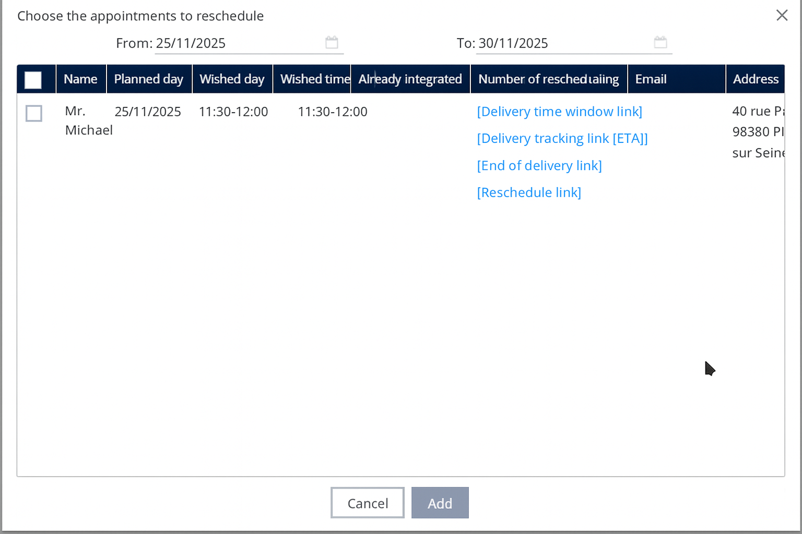

# Cancellazione della visita

## 1. Introduzione

Questo processo ti consente di contrassegnare una visita come annullata attivando contemporaneamente un'azione che invita il cliente finale a selezionare una nuova data e orario per la riprogrammazione.

## 2. Configurazione Iniziale&#x20;

Prima di configurare un annullamento, devi assicurarti che i canali di comunicazione siano attivi affinché il cliente riceva il link per la riprogrammazione.

1. **Accedi alle Impostazioni di Cancellazione:** Clicca sull' **cancellazione visita** opzione.
2. **Abilita Messaggi in Uscita:** Assicurati che entrambi i tipi di comunicazione in uscita siano attivati:
   * **E-mail in uscita**
   * **SMS in Uscita**
3. **Imposta l'Oggetto (E-mail e SMS):** Menziona l'**oggetto** specifico che vuoi che il cliente veda.

***

## 3. Spiegazione delle funzionalità e vantaggi

Questa funzionalità semplifica la comunicazione e la logistica quando un tentativo di consegna fallisce a causa dell'indisponibilità del cliente.

| Funzionalità                                    | Descrizione                                                                                                                                              |
| ----------------------------------------------- | -------------------------------------------------------------------------------------------------------------------------------------------------------- |
| **Link ETA**                                    | Un link contenente l'ora stimata di arrivo (ETA) viene creato automaticamente e inviato una volta che la consegna è iniziata.                            |
| **Modifica dell'Oggetto E-mail**                | Puoi inserire e personalizzare l'**oggetto dell'e-mail** così i clienti conoscono immediatamente lo scopo del messaggio.                                 |
| **Modifica del Corpo del Messaggio**            | Puoi liberamente **modificare il messaggio** che verrà inviato ai tuoi clienti, consentendo un linguaggio personalizzato e dettagli importanti           |
| **Tag di Personalizzazione ($)**                | Inserendo il **simbolo del dollaro** ($) vengono mostrate opzioni che puoi inserire e modificare direttamente nel corpo dell'e-mail, risparmiando tempo. |
| **Finestra di Anteprima**                       | Prima di salvare, puoi vedere l' **anteprima** del messaggio esatto che sarà inviato, assicurandoti che appaia professionale e accurato.                 |
| **Tracciamento della Posizione in Tempo Reale** | Il link permette al cliente di tracciare la posizione in tempo reale della consegna (o della risorsa).                                                   |
| **Email in Uscita**                             | Opzione per abilitare l'invio del link ETA via e-mail.                                                                                                   |
| **SMS in Uscita**                               | Opzione per abilitare l'invio del link ETA tramite messaggio di testo.                                                                                   |

💡 **Suggerimento:** Il corpo dell'e-mail include automaticamente le informazioni relative al **motivo della cancellazione** e la **data di riprogrammazione.**

**Inserisci Informazioni Personalizzate (Opzionale)** Per includere informazioni dinamiche (come il nome di un cliente o dettagli specifici dell'appuntamento), inserisci il **simbolo del dollaro** ($). Questo mostrerà opzioni che puoi usare per modificare il corpo dell'e-mail.

💡 **Suggerimento:** Usare i tag di personalizzazione rende il messaggio più diretto e professionale.

#### Gestione degli Appuntamenti Riprogrammati&#x20;

Dopo che una visita è stata annullata, il corriere deve reinserire l'appuntamento nel calendario una volta selezionata una nuova data.

**Trovare i Dati**

1. **Accedi a Evasione:** Vai alla **scheda evasione**.
2. **Visualizza Elenco Annullati:** Fai clic su **da riprogrammare**.
3. **Esamina i Dati:** Puoi **vedere qui i dati riprogrammati**.

<figure><figcaption></figcaption></figure>

**Aggiungere l'Appuntamento al Calendario**

1. **Accedi agli Strumenti del Corriere:** Il corriere dovrebbe cliccare su **"le mie consegne"**.
2. **Seleziona Appuntamenti:** Fai clic su **aggiungi appuntamenti da riprogrammare**.
3. **Elenca e Aggiungi:** **Elenca i dati qui** e clicca **aggiungi**.

**Risultato Atteso:** Le visite riprogrammate **verranno aggiunte con successo alla prossima simulazione/ottimizzazione**.

<figure><figcaption></figcaption></figure>

## 5. Consigli di Produttività

* **Abilita Sempre Entrambi:** Per raggiungere il maggior numero di clienti possibile, assicurati di **abilitare le e-mail in uscita e gli SMS in uscita** quando configuri la cancellazione. Questa funzionalità è disponibile su più canali, garantendo che i clienti possano accedervi anche se un metodo viene perso.
* **Usa la Funzione Anteprima:** Prima di cliccare **salva**, utilizza sempre la funzione per **vedere l'anteprima dell'e-mail**. Questo conferma che il motivo della cancellazione e il link per la riprogrammazione sono visualizzati correttamente, evitando errori di comunicazione.
* **Traccia gli Elementi Riprogrammati:** Controlla regolarmente **la scheda evasione** sotto la voce **da riprogrammare**. Questo assicura che nessuna visita annullata venga persa e mantiene aggiornato il tuo flusso logistico.
