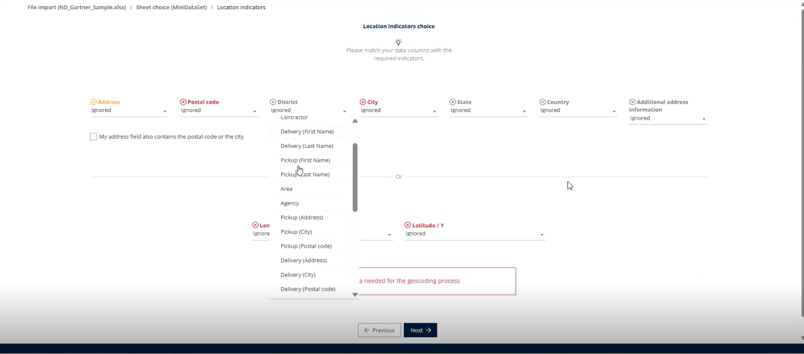

# 12. Come ottimizzare la geocodifica in TourSolver?

* **Fornire indirizzi completi e accurati**\
  Assicurarsi che ogni indirizzo includa il nome della via, il numero, il codice postale, la città e il paese. Dati puliti e coerenti migliorano i risultati della geocodifica.
*   **Usare campi separati per ogni componente dell'indirizzo**\
    TourSolver supporta due formati per l'inserimento delle informazioni sugli indirizzi:

    1. **Colonne strutturate** – Via, Codice Postale, Città e Paese inseriti separatamente.
    2. **Campo combinato singolo** – Indirizzo completo inserito in un'unica colonna.

    👉 Per garantire una geocodifica accurata, **scegliere un formato e usarlo in modo coerente**. Non mescolare colonne strutturate con un campo combinato nello stesso set di dati, poiché ciò potrebbe causare errori o incoerenze nel riconoscimento degli indirizzi.
*   **Verificare le informazioni sul distretto**\
    Per migliorare la precisione della geocodifica, sempre **specificare il distretto corretto** quando si inseriscono i dati degli indirizzi. TourSolver ora include una **colonna Distretto**, che aiuta il sistema a restringere la ricerca e individuare l'area corretta in modo più efficace.

    👉 L'uso coerente del campo distretto garantisce che gli indirizzi siano associati alla corretta zona geografica e riduce gli errori nella pianificazione dei giri.

<figure><figcaption></figcaption></figure>

* **Privilegiare le coordinate GPS quando disponibili**\
  Se disponi di valori di latitudine e longitudine, includili. TourSolver li utilizzerà direttamente e salterà la geocodifica degli indirizzi, ottenendo una maggiore precisione.
* **Rivedere la qualità della geocodifica dopo l'import**\
  Usa gli indicatori di qualità della geocodifica per identificare punti errati o di scarsa qualità e correggerli nei dati.
*   **Opzione di riposizionamento nell'app mobile**\
    Per migliorare la qualità della geocodifica, TourSolver offre un **opzione di riposizionamento** nella applicazione mobile. Questa funzione permette agli utenti di **aggiornare o precisare la posizione direttamente dal proprio dispositivo mobile**, assicurando che la posizione registrata sia accurata e allineata con il sito reale.

    👉 L'utilizzo dell'opzione di riposizionamento aiuta a correggere discrepanze minori e migliora la precisione degli indirizzi geocodificati nella pianificazione dei giri.
