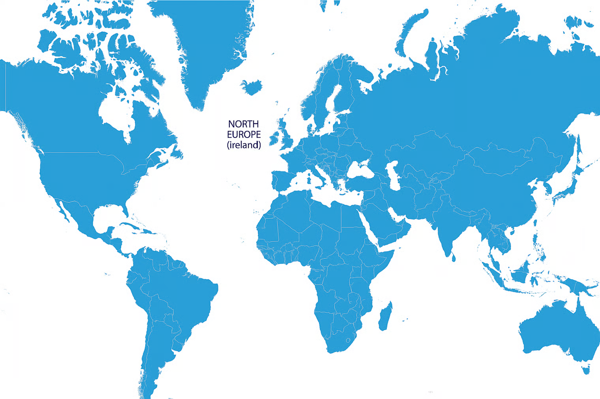

# 1. Dove sono ospitati i miei dati?

Dove vengono archiviati i tuoi dati e l'infrastruttura necessaria per utilizzare TourSolver dipenderà dall'ambito della tua copertura geografica e, quindi, in ultima analisi, dal paese in cui operi al momento dell'esecuzione delle ottimizzazioni dei giri.&#x20;

Per[ tutti i paesi supportati](https://www.toursolver.com/fr/faq/couverture-g%C3%A9ographique-de-toursolver) in TourSolver, l'hosting dell'infrastruttura Cloud e dei tuoi dati sarà in Europa e nell'Irlanda del Nord.

<figure><figcaption></figcaption></figure>
