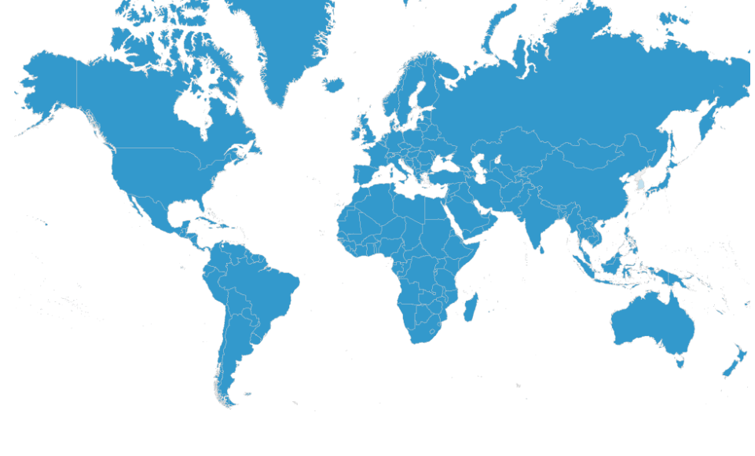

# 17. In quali paesi è disponibile TourSolver?

A partire dal **2 maggio 2018 (versione 5.0)**, TourSolver fornisce copertura e ottimizzazione in **circa 230 paesi**, rappresentando **oltre 7,2 miliardi di persone**.\
Con aggiunte recenti come **Bangladesh, Bhutan, Maldive, Nepal, Pakistan e Sri Lanka**, TourSolver ora copre **quasi l'intero pianeta**.

### **🌍 Paesi non coperti**

* **Corea del Nord**
* **Corea del Sud**

<figure><figcaption></figcaption></figure>

La copertura è organizzata per regione, e alcune regioni includono **settorizzazione geografica** (disponibile nella **versione Premium**). Di seguito è riportato l'elenco completo dei paesi coperti e lo stato di disponibilità della versione Premium.

***

### **🌍 Europa**

**Settorizzazione geografica disponibile in Premium**

ALBANIA, GERMANIA, ANDORRA, ARMENIA, AUSTRIA, AZERBAIGIAN, BIELORUSSIA, BELGIO, BOSNIA ED ERZEGOVINA, BRASILE, BULGARIA, CIPRO, CROAZIA, DANIMARCA, SPAGNA, ESTONIA, FEDERAZIONE RUSSA, FINLANDIA, FRANCIA, GEORGIA, GRECIA, GRENLANDIA, UNGHERIA, ISOLA DI MAN, ISOLE FAROE, IRLANDA, ISLANDA, ITALIA, KAZAKHSTAN, KIRGHIZISTAN, LETTONIA, LIECHTENSTEIN, LITUANIA, LUSSEMBURGO, MALTA, MONTENEGRO, NORVEGIA, UZBEKISTAN, PAESI BASSI, POLONIA, PORTOGALLO, MACEDONIA DEL NORD, MOLDAVIA, REPUBBLICA CECA, ROMANIA, REGNO UNITO, SERBIA, SLOVACCHIA, SLOVENIA, SVEZIA, SVIZZERA, TAGIKISTAN, TURKMENISTAN, TURCHIA, UCRAINA.

***

### **🌍 Africa e Medio Oriente**

**Settorizzazione geografica NON disponibile in Premium**

Afghanistan, Sudafrica, Algeria, Angola, Arabia Saudita, Bahrein, Striscia di Gaza, Benin, Botswana, Burkina Faso, Burundi, Camerun, Capo Verde, Comore, Repubblica Democratica del Congo, Repubblica del Congo, Costa d'Avorio, Gibuti, Egitto, Emirati Arabi Uniti, Eritrea, Etiopia, Gabon, Gambia, Ghana, Guinea, Guinea Equatoriale, Guinea-Bissau, Iraq, Iran, Israele, Giordania, Kenya, Kuwait, Lesotho, Libano, Liberia, Libia, Madagascar, Malawi, Mali, Marocco, Mauritius, Mauritania, Mayotte, Mozambico, Namibia, Niger, Nigeria, Oman, Uganda, Palestina, Qatar, Repubblica Centrafricana, Réunion, Ruanda, Sahara Occidentale, São Tomé e Príncipe, Senegal, Seychelles, Sierra Leone, Somalia, Sudan, Sudan del Sud, Sant'Elena–Ascensione–Tristão da Cunha, Swaziland (Eswatini), Siria, Tanzania, Ciad, Togo, Tunisia, Yemen, Zambia, Zimbabwe.

***

### **🌍 Nord e America Centrale**

**Settorizzazione geografica disponibile in Premium**

Bahamas, Belize, Bermuda, Canada, Costa Rica, Cuba, Isole Cayman, Repubblica Dominicana, Guatemala, Honduras, Haiti, Giamaica, Messico, Nicaragua, Panama, Porto Rico, El Salvador, Saint Pierre e Miquelon, Turks e Caicos, Stati Uniti, Isole Vergini Britanniche, Isole Vergini USA.

***

### **🌍 Sud America e Caraibi**

**Settorizzazione geografica NON disponibile in Premium**

Aruba, Anguilla, Argentina, Antigua e Barbuda, Sint Eustatius, Saba, Bonaire, Saint-Barthélemy, Bolivia, Brasile, Barbados, Cile, Colombia, Curaçao, Dominica, Ecuador, Isole Falkland, Guadalupa, Grenada, Guyana, Guyane, Saint Kitts e Nevis, Santa Lucia, Saint Martin, Montserrat, Martinica, Perù, Paraguay, Georgia del Sud e Isole Sandwich Australi, Suriname, Sint Maarten, Trinidad e Tobago, Uruguay, Saint Vincent e le Grenadine, Venezuela.

***

### **🌍 Asia**

**Settorizzazione geografica NON disponibile in Premium**

Bangladesh, Bhutan, Cina _(disponibile solo dall'interno della Cina)_, India, Maldive, Nepal, Pakistan, Sri Lanka, Giappone.

***

### **🌍 Sud-est asiatico**

**Settorizzazione geografica NON disponibile in Premium**

Brunei, Guam, Hong Kong, Indonesia, Cambogia, Laos, Macao, Myanmar, Mongolia, Isole Marianne, Malesia, Filippine, Isole Paracel, Palau, Papua Nuova Guinea, Singapore, Isole Salomone, Isole Spratly, Thailandia, Timor Est, Vietnam, Taiwan.

***

### **🌍 Oceania**

**Settorizzazione geografica NON disponibile in Premium**

Australia, Micronesia, Figi, Isole Cook, Isole Marshall, Kiribati, Nauru, Niue, Nuova Caledonia, Nuova Zelanda, Polinesia Francese, Samoa, Samoa Americane, Tokelau, Tonga, Tuvalu, Vanuatu, Wallis e Futuna.
