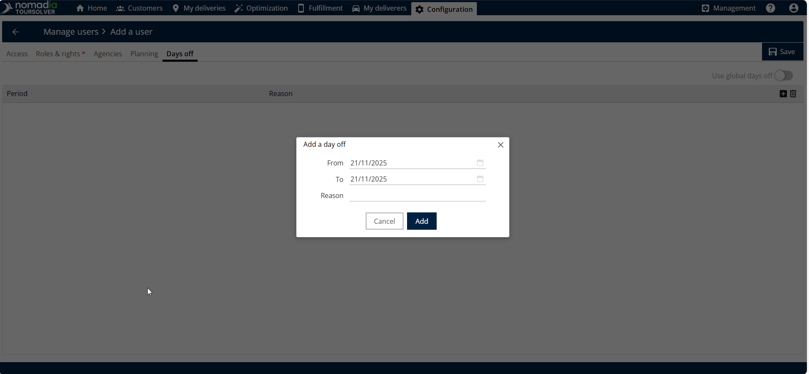

# Creare e modificare un utente

## 1. Introduzione

Questa guida fornisce istruzioni passo passo per configurare nuovi membri del team e aggiornare i dettagli, i ruoli o gli orari degli utenti attuali. Seguendo questi semplici passaggi, sarai in grado di gestire le impostazioni di accesso con sicurezza ed efficienza!

## 2. Configurazione Iniziale

Il primo passo per creare o modificare qualsiasi utente è accedere all'area principale di configurazione dalla pagina iniziale.

Per iniziare a creare o modificare un utente, segui questi passaggi:

1. Dalla **pagina iniziale**, vai alla **Configurazione.**
2. Fai clic su **Gestisci utenti.**

<figure><figcaption></figcaption></figure>

<figure><figcaption></figcaption></figure>

3. Fai clic su **Azioni**.
4. Fai clic su **Aggiungi**

<figure><figcaption></figcaption></figure>

## 3. Spiegazione delle funzionalità e vantaggi

Quando crei o modifichi un utente, interagisci con diverse sezioni chiave per definire il loro accesso e la pianificazione.

| Sezione              | Definizione                                                                                                                      | Azioni chiave                                                                                 |
| -------------------- | -------------------------------------------------------------------------------------------------------------------------------- | --------------------------------------------------------------------------------------------- |
| **Accesso**          | Definisce l'identità di base e le autorizzazioni di accesso (web e mobile) per l'utente.                                         | Inserisci l'ID di accesso, i nomi e imposta la password iniziale per l'utente mobile          |
| **Ruoli e diritti**  | Determina ciò che l'utente è autorizzato a vedere e fare all'interno dell'applicazione (ad es., amministratore, ottimizzazione). | Abilita i ruoli e i diritti necessari, come **amministratore** o **ottimizzazione**.          |
| **Agenzie**          | Assegna le specifiche agenzie di cui l'utente è responsabile o a cui deve avere accesso.                                         | Seleziona le agenzie richieste e usa la **freccia destra** per assegnarle.                    |
| **Planning**         | Ti permette di programmare l'orario di disponibilità per l'utente.                                                               | Seleziona il giorno e l'orario per impostare l'orario dello slot, quindi clicca **aggiorna**. |
| **Giorni di Riposo** | Ti consente di pianificare in anticipo e registrare eventuali giorni di riposo che l'utente intende prendere.                    | Inserisci **data di inizio** e **data di fine** per il periodo di riposo programmato.         |

**Nota**: Planning e giorni di riposo saranno accessibili solo all'utente mobile. Ruoli e diritti saranno accessibili solo all'utente web

## 4. Creazione utenti

Puoi creare un utente completamente da zero o modificare in modo efficiente un utente esistente utilizzando i suoi dettagli come modello.

### Crea un utente da zero

Questo è necessario quando si inserisce un nuovo dipendente che richiede un ID di accesso unico e ruoli definiti.

1. Dopo essere andato alla schermata Aggiungi, conferma che stai creando un utente da zero.
2. Prima, vediamo come creare l'utente da zero. Clicca su **OK** – Inizia la creazione di un nuovo utente.

<figure><figcaption></figcaption></figure>

<figure><figcaption></figcaption></figure>

3. Compila i dettagli di accesso: nella sezione Accesso, inserisci le informazioni richieste: **ID di accesso, nome e cognome**
4. Imposta **Tipo di accesso** e **Password:** Per l'accesso web, attiva l'opzione Accesso Web, e per l'accesso mobile, attiva l'opzione Accesso Mobile.
5. Inserisci la **password**

**Suggerimento**: Puoi attivare contemporaneamente sia le opzioni Accesso Web che Accesso Mobile se l'utente richiede entrambi. ⚠ Avviso (Requisiti della password): la password deve contenere 8 caratteri, incluso un carattere numerico e un carattere speciale.

<figure><figcaption></figcaption></figure>

<figure><figcaption></figcaption></figure>

6. **Definisci ruoli e diritti**: Nella sezione Ruoli e Diritti, abilita tutti i ruoli necessari, come amministratore, ottimizzazione o deposito.&#x20;
7. **Assegna agenzie**: Nella sezione Agenzie, clicca sulle agenzie che devi assegnare, quindi clicca la freccia destra per spostarle nella lista assegnata.

<figure><figcaption></figcaption></figure>

<figure><figcaption></figcaption></figure>

8. **Planning orari degli slot**: Nella sezione Planning, clicca il giorno e l'orario per impostare l'orario dello slot desiderato, quindi clicca aggiorna.

<figure><figcaption></figcaption></figure>

<figure><figcaption></figcaption></figure>

**Programma giorni di riposo (opzionale): nella sezione Giorni di riposo, puoi pianificare future assenze:**

9. Clicca sull' **più (+)** icona sul lato destro.
10. Inserisci **la data di inizio** e la **data di fine** per il giorno di riposo.
11. Fai clic su **Aggiungi**

<figure><figcaption></figcaption></figure>

<figure><figcaption></figcaption></figure>

12. **Salva l'utente**: Dopo aver compilato tutte le informazioni richieste, clicca su **Salva** per finalizzare la creazione.

<figure><figcaption></figcaption></figure>

<figure><figcaption></figcaption></figure>

**Risultato&#x20;**_**Previsto**:_ L'utente è stato creato con successo

<figure><figcaption></figcaption></figure>

### Modificare un utente esistente

Puoi aggiornare facilmente le informazioni di un utente esistente, come i suoi ruoli, le agenzie o il planning, senza ricominciare da capo.

1. **Seleziona utente esistente:** Attiva il bottone "Sì" nella sezione crea da un utente esistente.
2. **Scegli l'utente**: Seleziona lo specifico utente che desideri modificare, e poi clicca su **OK**.

<figure><figcaption></figcaption></figure>

3. **Modifica informazioni**: Tutte le informazioni dell'utente verranno copiate automaticamente dall'utente selezionato. Controlla le diverse sezioni (Accesso, Ruoli e Diritti, Planning, etc.) e modifica le informazioni esistenti secondo necessità.
4. **Salva modifiche:** Una volta aggiornate le informazioni necessarie, clicca su Salva per completare la modifica.

<figure><figcaption></figcaption></figure>

<figure><figcaption></figcaption></figure>

## 5. Consigli di Produttività

Ecco alcuni consigli e avvertenze utili per assicurare che il processo di gestione utenti proceda senza intoppi:

* 💡 **Accesso doppio:** Ricorda che puoi abilitare sia **accesso web** che **accesso mobile** simultaneamente per un utente, dando loro flessibilità nel modo in cui interagiscono con il sistema.
* ⚠️ **Chiarezza sulla password:** Quando imposti una password, assicurati che soddisfi i criteri di sicurezza: deve essere **8 caratteri** di lunghezza e includere almeno **un carattere numerico** e **un carattere speciale**.
* ⚠️ **Evita e-mail duplicate:** Se provi a inserire un indirizzo e-mail già utilizzato da un altro utente, il sistema mostrerà un messaggio di errore che afferma che **"l'indirizzo e-mail è già utilizzato"**. Dovrai usare un indirizzo e-mail univoco per procedere.
