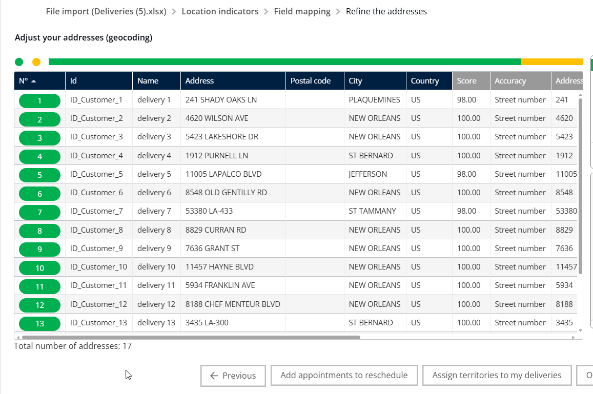

# Import delle consegne/visite

## 1. Introduzione

Benvenuto! Questa guida è progettata per rendere l'import dei tuoi dati di consegna/visite nel server un'esperienza fluida e di successo.

L'import ti consente di caricare un elenco di indirizzi e informazioni sui clienti direttamente nel sistema per la visualizzazione e l'ottimizzazione dei giri. Seguendo questi semplici passaggi, abbinerai le colonne del tuo foglio di calcolo ai campi richiesti dal sistema, visualizzerai le posizioni su una mappa e inizierai a ottimizzare i tuoi giri di consegna/visite.

***

## 2. Configurazione Iniziale

#### Accesso a Le mie consegne

Per iniziare a importare le tue consegne, devi prima navigare:

1. Dal menu principale a **Le mie consegne**.
2. Ora sei pronto per importare i tuoi **Dati.**

#### Scaricare dati di esempio

Se non sei sicuro di come formattare il tuo file Excel, puoi scaricare un modello di esempio. L'utilizzo dei dati di esempio garantisce che il tuo file sia pronto per l'import immediatamente.

1. Fai clic su **Scarica**.
2. Il file Excel contenente i dati di esempio verrà scaricato.

<figure><figcaption></figcaption></figure>

<figure><figcaption></figcaption></figure>

💡 **Suggerimento** : Usa sempre i dati di esempio forniti se sei nuovo alla struttura del sistema. Questo spesso riduce potenziali errori di mappatura in seguito!

***

## 3. Spiegazione delle funzionalità con vantaggi

Il processo di importazione include diversi passaggi chiave che aiutano a garantire che i tuoi dati siano preparati accuratamente per la pianificazione dei giri:

| Funzionalità                | Contesto e vantaggio                                                                                                                                                                                                                                         |
| --------------------------- | ------------------------------------------------------------------------------------------------------------------------------------------------------------------------------------------------------------------------------------------------------------ |
| **Mappatura dei dati**      | Questo assicura che le intestazioni delle colonne nel tuo foglio di calcolo caricato (come "Cust ID" o "Nome cliente") siano correttamente abbinate ai campi utilizzati dal server. Questo abbinamento preciso è fondamentale per un instradamento accurato. |
| **Colori di geocodifica**   | Dopo l'import, il sistema prova automaticamente a trovare la posizione precisa (geocodifica) di ogni indirizzo di consegna/visita. I colori indicano successo o fallimento, permettendoti di individuare e correggere rapidamente gli errori.                |
| **Ottimizzazione dei giri** | Questo è il passaggio finale in cui il sistema calcola l'ordine e il percorso più efficienti per le tue consegne/visite importate.                                                                                                                           |

## 4. Import delle consegne/visite e ottimizzazione dei giri

Questa attività copre il processo di caricamento dei tuoi dati di consegna/visita, la verifica dell'abbinamento dei campi e l'avvio della pianificazione dei giri.

#### Import dei dati e mappatura dei campi

Devi indicare al sistema quali colonne del tuo foglio di calcolo corrispondono ai campi del sistema (come ID cliente o Nome).

1. Fai clic su **Importa** per avviare il processo di import dei tuoi dati nel server

<figure><figcaption></figcaption></figure>

2. Apparirà una finestra di mappatura che ti inviterà ad abbinare i campi del tuo Excel con i campi richiesti dal server.
3. Se un campo è già abbinato correttamente (come succede se usi il modello), puoi saltare la mappatura per quel campo.

**Per reimpostare o sistemare una mappatura di campo (usando come esempio ID cliente e Nome):**

4. Se un campo è attualmente mappato, puoi scegliere di ignorarlo.
5. Fai clic su _Ignorato_ per mappare il campo a un vincolo diverso da quelli per TourSolver.

<figure><figcaption></figcaption></figure>

<figure><figcaption></figcaption></figure>

6. Fai clic su **mostra tutto** per visualizzare tutte le possibili opzioni di campi da abbinare.

<figure><figcaption></figcaption></figure>

7. Clicca sul **ID cliente** per mapparlo.

<figure><figcaption></figcaption></figure>

8. Se devi modificare il campo Nome, fai clic su Ignora sotto l'attuale mappatura del nome.

<figure><figcaption></figcaption></figure>

9. Fai clic su **Nome** per completare la mappatura per il campo Nome

<figure><figcaption></figcaption></figure>

#### Revisione dei dati e risultati di geocodifica

Dopo aver confermato la mappatura dei dati, puoi procedere alla visualizzazione sulla mappa per rivedere i risultati della geocodifica.

1. Fai clic su **Avanti** una volta completata la mappatura

<figure><figcaption></figcaption></figure>

2. Apparirà la vista mappa, mostrando le tue posizioni con i colori della geocodifica

<figure><figcaption></figcaption></figure>

3. Verifica le **posizioni** e i loro **colori**.
4. Se vedi posizioni di colore grigio, gli indirizzi non sono stati trovati dal sistema. Potrebbe essere necessario rivedere e correggere questi indirizzi nei tuoi dati originali prima di ottimizzare il percorso per accuratezza

<figure><figcaption></figcaption></figure>

5. Fai clic su **Ottimizza i miei percorsi** per iniziare il calcolo del giro

<figure><figcaption></figcaption></figure>

6. Una volta che **Avvii l'ottimizzazione**, il sistema inizierà il processo di calcolo.

<figure><figcaption></figcaption></figure>

## 5. Comprendere lo stato della geocodifica

Quando appare la vista mappa, i colori ti guidano per capire se i tuoi indirizzi sono stati posizionati correttamente (geocodificati):

* Il colore giallo indica che la posizione è stata geocodificata con successo a **livello di via**.

<figure><figcaption></figcaption></figure>

* Il colore verde indica che la posizione è stata geocodificata con successo a **livello di edificio**.

<figure><figcaption></figcaption></figure>

<figure><figcaption></figcaption></figure>

* Il colore grigio indica che la posizione non è stata geocodificata.

<figure><figcaption></figcaption></figure>

<figure><figcaption></figcaption></figure>

***

## 6. Suggerimenti per la produttività

Ecco alcuni modi per rendere l'import dei dati più veloce e più accurato:

* 💡 **Dai priorità al giallo:** Quando esamini la vista mappa, sai che le posizioni gialle sono affidabili (geocodificate a livello di via). Concentrati su qualsiasi posizione contrassegnata **Grigio**.
* 💡 **Massimizza l'efficienza della mappatura:** Se devi modificare rapidamente l'abbinamento di un campo, ricorda che puoi scegliere di **Ignorare** l'attuale mappatura e quindi selezionare immediatamente il nome del campo corretto. Questo procedimento risulta più veloce che correggere i dati nel tuo foglio di calcolo al di fuori del sistema.
