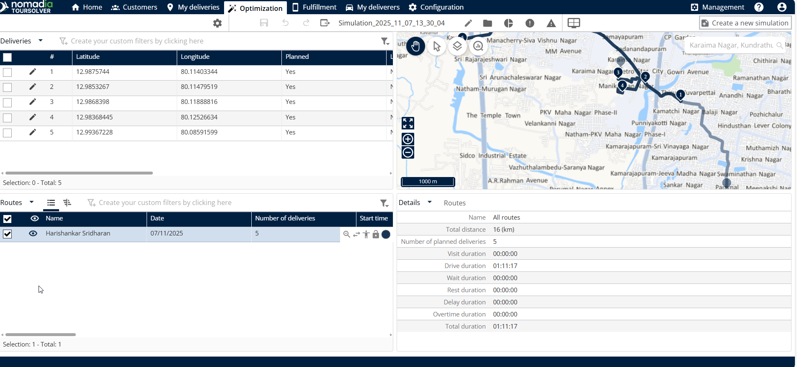
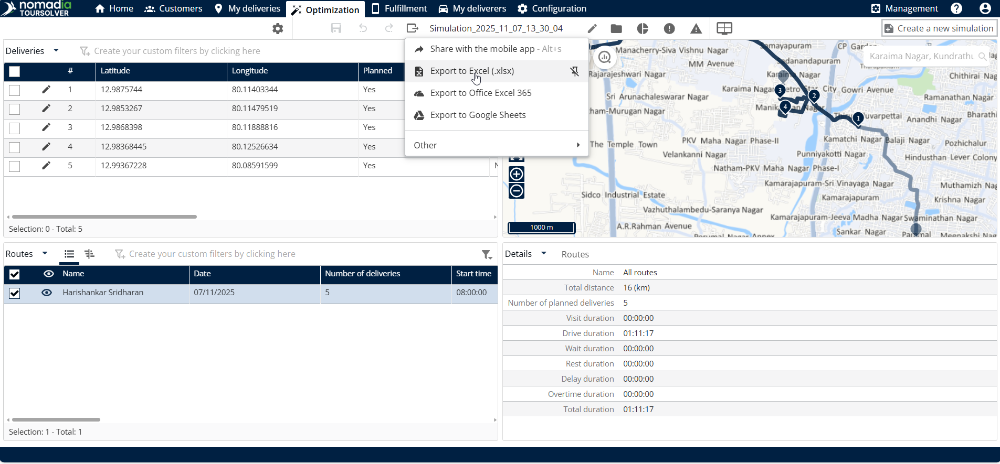
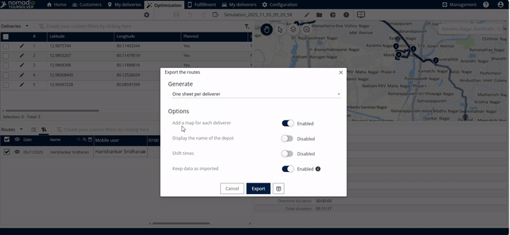
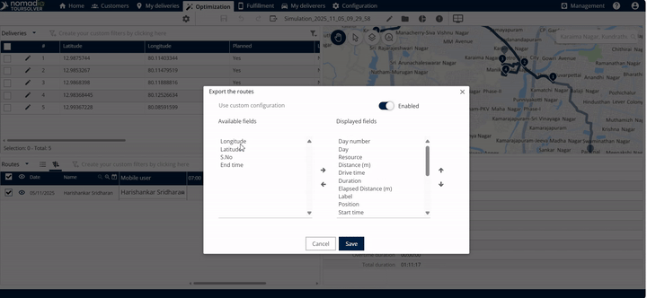
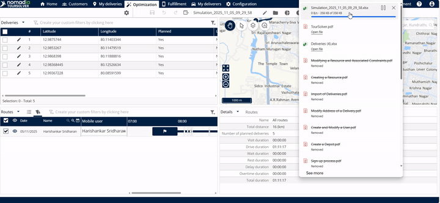
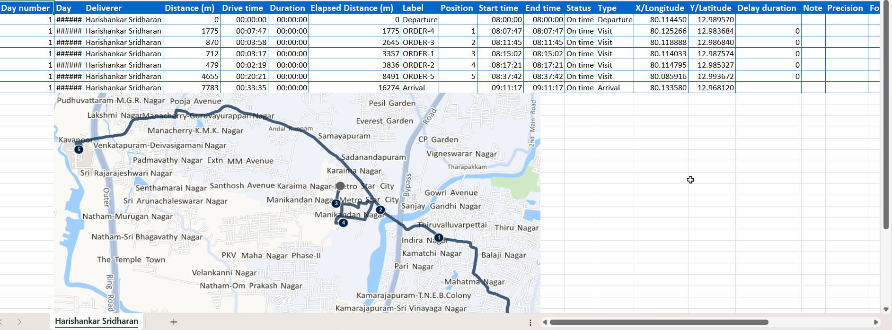

# Esporta i miei giri

## 1. Introduzione

Questa guida ti insegnerà come selezionare, personalizzare ed esportare i tuoi giri completati utilizzando il sistema di gestione dei giri. Che tu debba condividere i risultati con un membro del team tramite Excel o integrare i dati in un calendario, questo processo è progettato per essere semplice ed efficace.

## 2. Configurazione Iniziale

**Personalizzare le impostazioni di export in Excel**

Quando scegli di esportare in Excel, il sistema offre diverse opzioni per personalizzare il file risultato.

1.  **Seleziona il layout del foglio:** Scegli come vengono organizzati i dati del giro:

    * **Un foglio per tutte le risorse**.
    * **Un foglio per ogni risorsa**.
    * _**Contesto**:_ Questo ti aiuta a decidere se vuoi una vista consolidata o report dettagliati per i singoli membri del team.

    
<figure><figcaption></figcaption></figure>

💡 **Suggerimento:** Queste configurazioni si applicano solo all'opzione di esportazione in Excel. Altri formati (come PowerPoint o Calendario) utilizzeranno le impostazioni di output standard.

2. **Selezione dei campi personalizzati (colonne)**

Puoi scegliere quali colonne specifiche (campi) appariranno nel file esportato.

1. Fai clic su **altro** all'interno della finestra di configurazione.
2. Vedrai un elenco di **campi disponibili** e **campi di visualizzazione**.

<figure><figcaption></figcaption></figure>

3. Puoi anche **abilitare la configurazione personalizzata** se necessario.

* _Contesto:_ Al termine, il file di export conterrà sia **colonne standard che mappate**.

4. Fai clic su **Salva** quando avrai finito di personalizzare i campi.

***

## 3. Spiegazione delle funzionalità e vantaggi

Il vantaggio principale della funzione di export dei giri è la sua flessibilità, che ti consente di condividere rapidamente i dati in formati adatti a diversi stakeholder.

#### Destinatari di export diversi

Cliccando su **opzione di export** e selezionando **altro**, sblocchi una vasta gamma di tipi di export.

| Funzione di export                                                | Vantaggio/Utilità                                                                                                 |
| ----------------------------------------------------------------- | ----------------------------------------------------------------------------------------------------------------- |
| **Esporta in Excel**                                              | Ideale per analisi dettagliate dei dati, calcoli e report strutturati.                                            |
| **Esporta in PowerPoint / Office 365 PowerPoint / Google Slides** | Utile per generare rapidamente presentazioni o riepiloghi per riunioni.                                           |
| **Esporta in Calendario (Office Outlook / Google)**               | Consente di integrare orari e pianificazioni delle rotte direttamente nei calendari personali o di team.          |
| **Esporta un riepilogo dei giri inviato via e-mail**              | Condivide in modo efficiente una panoramica di alto livello del piano dei giri con i destinatari.                 |
| **Esporta in Masternaut .GPX / .GPX Esteso**                      | Necessario per l'utilizzo con specifici sistemi di navigazione GPS o software di mappatura avanzata.              |
| **Esporta in formato KML Google etc.**                            | Formato standard per visualizzare dati geospaziali (come i giri) in strumenti di mappatura (ad es. Google Earth). |
| **Esporta in Webhook**                                            | Facilita il trasferimento automatizzato dei dati ad altri sistemi operativi.                                      |

## 4. Esportare un giro in Excel

Questa è l'attività più comune e include la selezione del giro, la scelta della destinazione, la configurazione delle impostazioni e la finalizzazione del download.

Segui questi passaggi per esportare con successo il giro selezionato:

**Individua la sezione Ottimizzazione**

1. Inizia dalla **pagina principale**. Clicca su Ottimizzazione

**Seleziona il giro**

2. **Clicca sul gito** che desideri esportare.

<figure><figcaption></figcaption></figure>

3. **Avvia la finestra di dialogo di export**

**Scegli il formato Excel**

4. Poiché desideri esportare i dati in Excel, clicca su **esporta in Excel**.

<figure><figcaption></figcaption></figure>

**Configura e genera il file**

5. Rivedi le impostazioni di configurazione iniziali (Layout del foglio, Orari, Integrità dei dati) come descritto nella Sezione 2.

<figure><figcaption></figcaption></figure>

6. Se hai personalizzato i campi, assicurati di aver cliccato **Salva**.

<figure><figcaption></figcaption></figure>

**Finalizza l'export e apri il file**

7. Clicca sul **file scaricato** per aprirlo

<figure><figcaption></figcaption></figure>

8. Trova il **file excel scaricato** di seguito.

<figure><figcaption></figcaption></figure>

***

## 5. Consigli di Produttività

Ecco alcuni modi per rendere più efficiente il processo di export dei giri:

* **Personalizza le colonne per efficienza (filtraggio dei dati):** Se hai bisogno solo di due o tre punti dati specifici per un'analisi rapida, usa l'opzione **altro** nel menu di configurazione per rimuovere i campi non necessari. Questo mantiene il tuo report pulito e mirato, assicurando che il file di export contenga solo **colonne standard mappate** che contano di più.
* **Usa l'export in calendario per la programmazione:** Invece di esportare dati complessi, utilizza l'opzione **esporta in calendario** per Office Outlook o Google per fornire rapidamente alle risorse gli orari definitivi dei turni e gli appuntamenti dei giri, semplificando la logistica quotidiana.
* **Risparmia tempo di configurazione:** Una volta impostato il layout del foglio desiderato e le selezioni dei campi (come generare **un foglio per ogni risorsa** o includere **orari dei turni**), clicca **Salva**. Questo ti permette di eseguire rapidamente l'export in futuro senza dover ristabilire tutte le configurazioni dettagliate.
