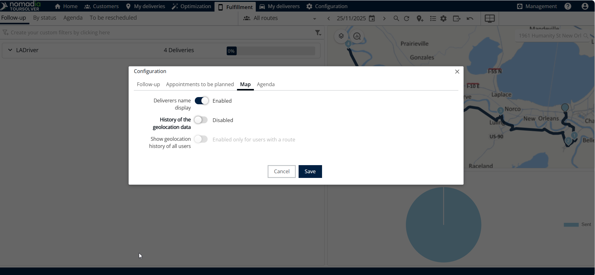

# Come geolocalizzo le mie risorse

## 1. Introduzione

La possibilità di localizzare il tuo team di risorse in tempo reale è cruciale per una gestione efficace delle risorse. Questa guida semplifica il processo di abilitazione degli accessi necessari e di configurazione delle impostazioni dell'app mobile in modo che tu possa tracciare facilmente le tue risorse.

## 2. Configurazione iniziale

Prima di iniziare, il sistema presuppone che tu abbia già configurato le risorse e i loro percorsi pianificati. Se questi passaggi non sono completi, devi prima creare la consegna, le risorse e il percorso.

### Requisiti di sistema (Configurazione degli accessi)

Per garantire un tracciamento efficace, il personale deve avere i permessi corretti e l'accesso abilitato sia per la piattaforma web di back office che per l'app mobile.

**Azione prerequisito**

| Tipo di accesso                                 | Descrizione                                                             |
| ----------------------------------------------- | ----------------------------------------------------------------------- |
| **Configurazione della risorsa e del percorso** | La risorsa e il percorso assegnato devono essere già creati.            |
| **Accesso web (back office)**                   | Necessario per l'accesso al sistema.                                    |
| **Accesso mobile**                              | Richiesto per l'utilizzo dell'app mobile, che facilita il tracciamento. |

## 3. Spiegazione delle funzionalità e vantaggi

Il sistema offre funzionalità chiave che ti aiutano a gestire la sicurezza, i permessi e la visibilità del tracciamento:

* **Gestione ruoli e diritti**: Qui concedi alle risorse i permessi necessari per operare nel sistema.
* **Configurazione dell'app mobile**: Questa sezione ti permette di perfezionare il modo in cui l'app mobile comunica con il sistema, inclusa la velocità di sincronizzazione e la visibilità dell'agenda.
* **Impostazioni sulla privacy**(**Conformità al GDPR**): Hai il potere di limitare quando avviene il tracciamento, aderendo alle regole sulla privacy dei dati. Questo costruisce fiducia e garantisce conformità legale limitando il tracciamento della geolocalizzazione solo alle ore e ai giorni lavorativi.

## 4. Abilitazione del tracciamento della geolocalizzazione

### Configura l'app mobile

**Modifica le impostazioni generali.**&#x20;

1. Numero di giorni raggiungibili nell'agenda
2. Frequenza di sincronizzazione automatica
3. Mostra informazioni sul tempo di viaggio

4. **Imposta regole sulla privacy**: Nella configurazione dell'app mobile, abilita la privacy secondo le regole rilevanti (come il GDPR).

⚠ **Avvertenza**: Se operi in una regione con leggi severe sulla privacy dei dati (come il GDPR), assicurati di abilitare il tracciamento solo durante le ore lavorative e nei giorni lavorativi per rimanere conforme.

### Visualizzazione della geolocalizzazione nella scheda Adempimento

1. Una volta completata la configurazione, puoi accedere alla vista di tracciamento nella scheda Adempimento
2. **Seleziona data**: Inserisci la data specifica che è stata pianificata per il giro che desideri tracciare.

>)

3. **Apri impostazioni di visualizzazione**: Clicca su **impostazioni**.
4. **Modifica vista di tracciamento**: Qui puoi regolare come vengono visualizzate le informazioni di tracciamento: **Campi disponibili, Campi da visualizzare, Appuntamenti da pianificare, Mappa e Agenda**

<figure><figcaption></figcaption></figure>

3. Clicca sulla mappa per attivare e visualizzare la cronologia della geolocalizzazione.

<figure><figcaption></figcaption></figure>

## 5. Consigli di produttività

Ecco alcuni suggerimenti per massimizzare l'uso della funzione di tracciamento:

* **Personalizza la tua vista**: Usa il menu delle impostazioni nella scheda Adempimento per modificare ciò che vedi sullo schermo. Se hai bisogno solo del tracciamento della posizione, assicurati che le visualizzazioni **mappa** e **agenda** siano abilitate.
* **Monitora il tempo di viaggio**: Assicurati di rivedere la configurazione dell'app mobile per **mostrare informazioni sul tempo di viaggio**. Questo ti aiuta a prevedere con precisione gli orari di arrivo e a gestire le aspettative.
* **Mantieni la sincronizzazione frequente**: Se il tracciamento in tempo reale è critico, controlla l'impostazione **frequenza di sincronizzazione automatica** nell'impostazione dell'app mobile. Una frequenza maggiore fornisce aggiornamenti di posizione più immediati.
