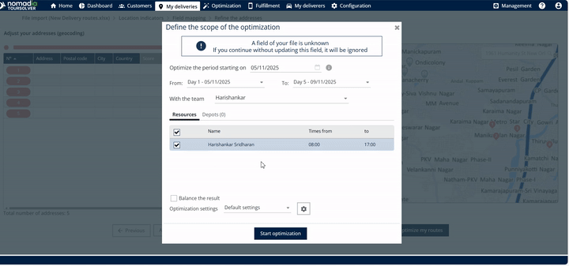
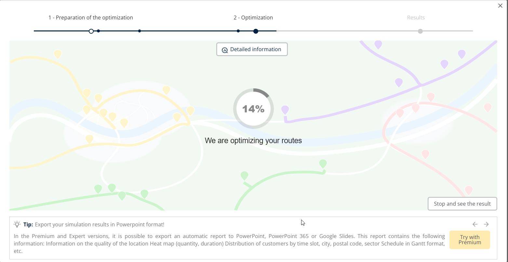
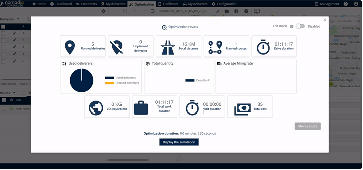
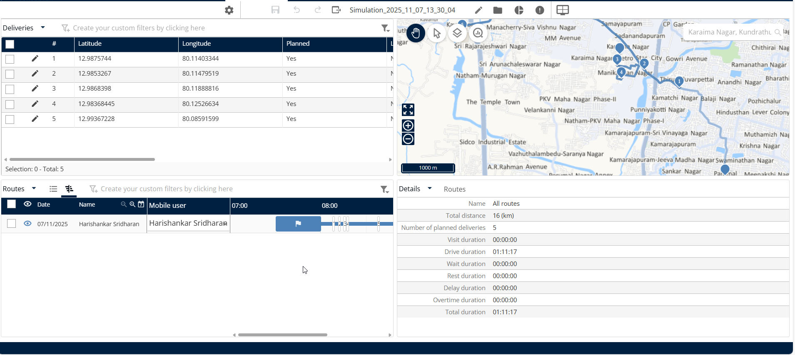
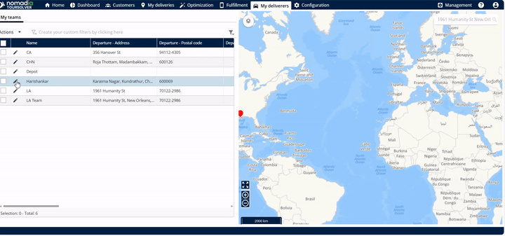
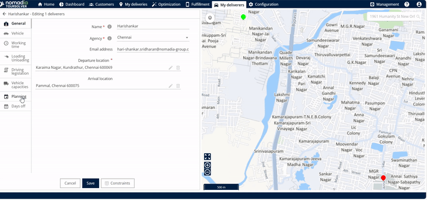
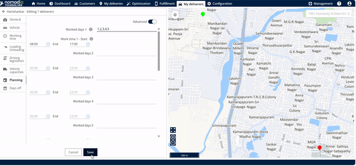

# Ottimizza le tue consegne/visite

## 1. Introduzione

La funzione **Ottimizza le tue consegne** semplifica le tue operazioni calcolando la migliore sequenza e i percorsi di consegna possibili. Usando questa guida, imparerai come impostare le preferenze di ottimizzazione e avviare con successo il processo di pianificazione dei giri.

***

## 2. Configurazione iniziale

Per iniziare a usare la funzione di ottimizzazione, si presume che tu abbia già importato i dati delle consegne/visite nel sistema.

Prima di poter iniziare l'ottimizzazione, devi navigare al punto di partenza del processo.

1. Vai a **Le mie consegne** / Le mie visite
2. Dopo aver verificato che le consegne/visite siano state importate, fai clic su **Avanti**.
3. Fai clic su **Ottimizza i miei giri**.

***

## 3. Spiegazione delle funzionalità e vantaggi

**Ottimizza le tue consegne/visite** offre due principali funzionalità di personalizzazione che ti danno il controllo su come vengono pianificati i giri:

* **Ottimizzazione dei giri:** Questa funzione principale prende tutte le tue consegne/visite importate e calcola il giro più efficiente.
  * **Vantaggio:** Consegne ottimizzate con successo, garantendo un uso efficiente del tempo e delle risorse.
* **Date di ottimizzazione modificabili:** Puoi specificare esattamente quando i giri ottimizzati devono iniziare andando ad inserire o modificare la data di inizio e la data di fine.
* **Giorni di pianificazione modificabili:** Hai la possibilità di regolare il numero di giorni per i quali il sistema dovrebbe pianificare. Questo è utile se le tue esigenze operative cambiano.

## 4. Avvio dell'ottimizzazione dei giri

Questa attività ti guida nella selezione dell'intervallo di tempo e nell'avvio del processo di calcolo dei giri.

1. **Imposta l'intervallo di date per l'ottimizzazione:** Nella schermata di ottimizzazione, inserisci o modifica la data di inizio e la data di fine desiderate per i giri ottimizzati.
2. **Modifica il numero di giorni (opzionale):** Se necessario, puoi modificare il numero di giorni di pianificazione direttamente in questa schermata.

<figure><figcaption></figcaption></figure>

3. Fai clic su **Avvia ottimizzazione**

<figure><figcaption></figcaption></figure>

#### Visualizzazione dei risultati dell'ottimizzazione

1. Fai clic su Avvia ottimizzazione

<figure><figcaption></figcaption></figure>

2. Una volta avviata l'ottimizzazione, puoi monitorare i risultati.

<figure><figcaption></figcaption></figure>

**Rivedi i risultati:** Vedrai il riepilogo dei risultati dell'ottimizzazione.

3. Fai clic su **Mostra la simulazione**

<figure><figcaption></figcaption></figure>

4. Le consegne sono state ottimizzate con successo.

<figure><figcaption></figcaption></figure>

#### Regolazione del periodo di pianificazione (numero di giorni)

Se hai bisogno di cambiare per quanti giorni il sistema dovrebbe pianificare i giri, puoi configurare questa impostazione all'interno di **I miei autisti /** **le mie Risorse**.

1. Vai a **I miei autisti /** le mie risorse
2. Trova la risorsa associata alla consegna/visite.

<figure><figcaption></figcaption></figure>

3. Fai clic su **Planning**

<figure><figcaption></figcaption></figure>

3. **Modifica giorni:** Cambia il valore con il nuovo numero di giorni che desideri utilizzare per la pianificazione.
4. Fai clic su **Salva**

<figure><figcaption></figcaption></figure>

## 5. Consigli per la produttività

* ⏳ **Suggerimento: sii paziente con i lavori di grandi dimensioni:** Se hai molte consegne/visite che necessitano di ottimizzazione, il processo potrebbe richiedere più tempo del previsto. Questo è normale perché il sistema sta eseguendo calcoli complessi.
* ✅ **Suggerimento: controlla i risultati in anticipo:** Non è sempre necessario aspettare che l'intero processo finisca. Se hai bisogno di un risultato preliminare rapidamente, puoi fare clic su **Interrompi e vedere il risultato** in qualsiasi momento durante il calcolo.
* 🎉 **Conferma di successo:** Una volta che il sistema conferma che "Le consegne sono state ottimizzate con successo", sai che i tuoi nuovi giri sono pronti per essere implementati.
