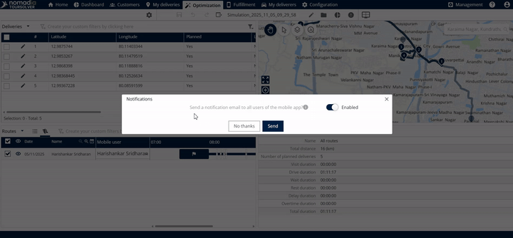
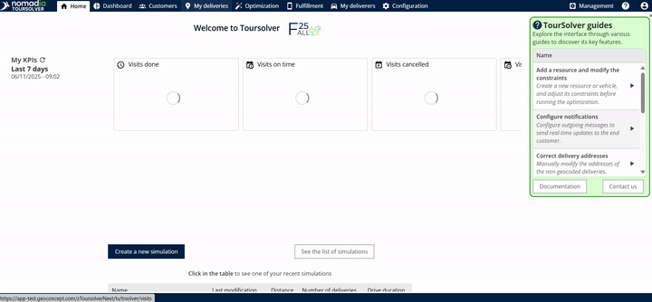
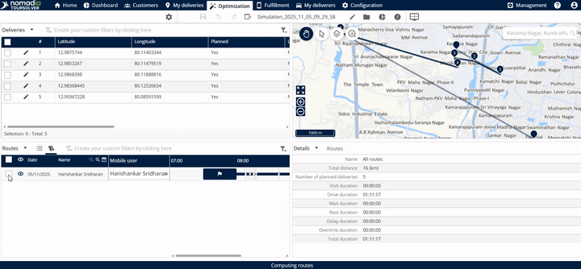
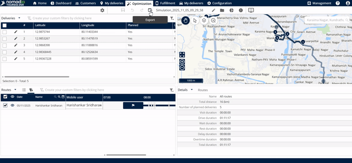
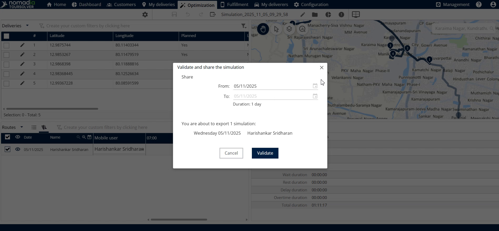
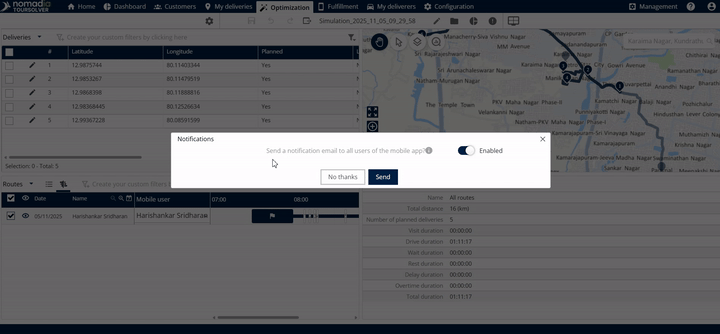
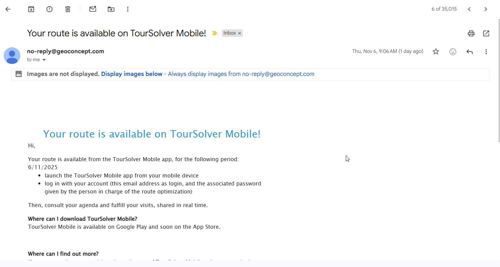

# Condividi un percorso con l'app mobile

## 1. Introduzione

Questa guida ti accompagna nel processo di export di un giro pianificato all'applicazione mobile utilizzata dal tuo team sul campo. Questo processo garantisce che gli utenti mobili ricevano una notifica via e-mail o SMS contenente il giro condiviso e le relative consegne/visite.

## 2. Configurazione Iniziale

Per condividere correttamente un giro, devi prima accedere alla sezione di ottimizzazione e selezionare un giro completato.

| Tipo di account           | Notifica inviata   | Contenuto inviato                                                                     |
| ------------------------- | ------------------ | ------------------------------------------------------------------------------------- |
| **Versione di prova**     | Notifica SMS       | Link per scaricare l'app mobile                                                       |
| **Versione sottoscritta** | E-mail di notifica | Notifica a tutti gli utenti dell'app mobile selezionati che il giro è stato condiviso |

## 3. Spiegazione delle funzionalità con vantaggi

La funzione **Condividi con l'app mobile** è cruciale per collegare i tuoi sforzi di pianificazione con l'esecuzione nel mondo reale.

* **Trasferimento del giro senza interruzioni:** Trasferisci facilmente giri complessi e ottimizzati direttamente sul dispositivo mobile dove sono necessari.
* **Condivisione specifica per data:** Puoi controllare l'intervallo di date esatto per il quale il giro è attivo e accessibile nell'app mobile. Condividere un giro per un intervallo di date specifico (ad es. durata di 1 giorno) conferma esattamente quali consegne/visite devono essere effettuate nelle date selezionate.
* **Feedback di conferma:** Il sistema fornisce un feedback chiaro riguardo a quante consegne/visite vengono condivise e quante notifiche vengono inviate agli utenti mobili.

## 4. Comprendere le notifiche

Dopo aver condiviso il giro, il sistema determina come vengono consegnate le notifiche in base alle impostazioni del tuo account.

<figure><figcaption></figcaption></figure>

## 5. Condivisione di un giro

Segui questi passaggi dettagliati per condividere con successo il tuo giro ottimizzato con i tuoi utenti mobili.

### Export e condivisione di un giro ottimizzato

1. Fai clic su **Ottimizzazione**

<figure><figcaption></figcaption></figure>

2. Scegli il **giro desiderato** dall'elenco

<figure><figcaption></figcaption></figure>

3. Fai clic su **Esporta** e fai clic su **Condividi con l'app mobile**

<figure><figcaption></figcaption></figure>

4. **Imposta la data di inizio (Data di inizio):** Inserisci la data di inizio dalla quale desideri che il giro venga condiviso.
5. Scegli un **Data di inizio desiderata**
6. **Imposta la data di fine (Data di fine):** Scegli una "**data di fine**".

<figure><figcaption></figcaption></figure>

**Nota**: La durata standard sarà di 1 giorno, ma puoi regolare la "data di fine" se necessario per creare giri di più giorni.\
Interfaccia di selezione della data che mostra Data di inizio, Data di fine e Durata (1 giorno)

<figure><figcaption></figcaption></figure>

7. **Rivedi la notifica (Prova/Sottoscritta):** Leggi la notifica di conferma mostrata in base al fatto che tu stia utilizzando una versione di prova o sottoscritta.
8. Fai clic su **Invia**

<figure><figcaption></figcaption></figure>

&#x20; **Risultato previsto**: Pop-up di conferma finale che mostra i dettagli delle consegne/visite condivise e le e-mail inviate

<figure><figcaption></figcaption></figure>

## 6. Consiglio di produttività

* **Suggerimento: Verifica il conteggio delle consegne/visite:** Presta sempre molta attenzione alla notifica finale che appare quando fai clic su **invia.** Questo messaggio conferma esattamente quante consegne/visite sono incluse nel giro che stai condividendo e quante e-mail vengono inviate ai tuoi utenti mobili.
