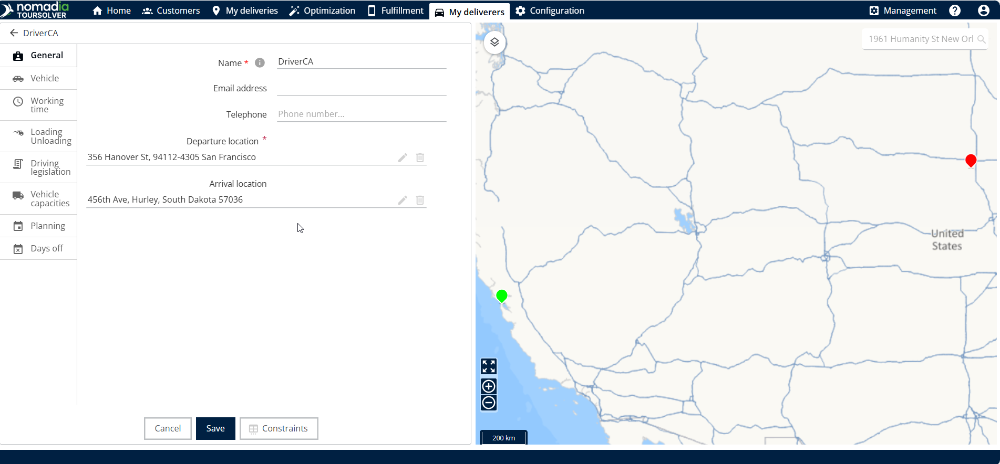
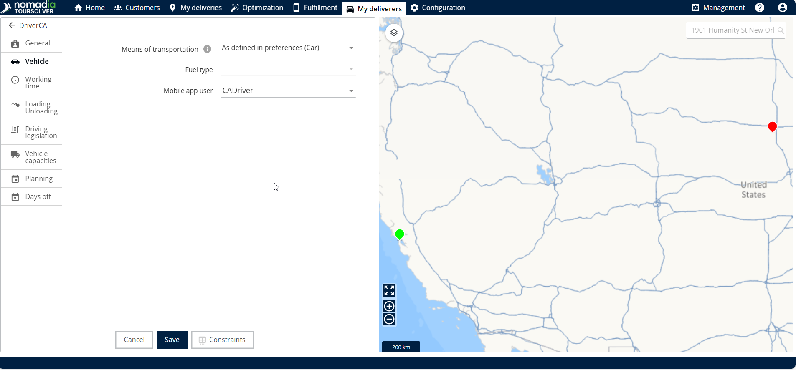
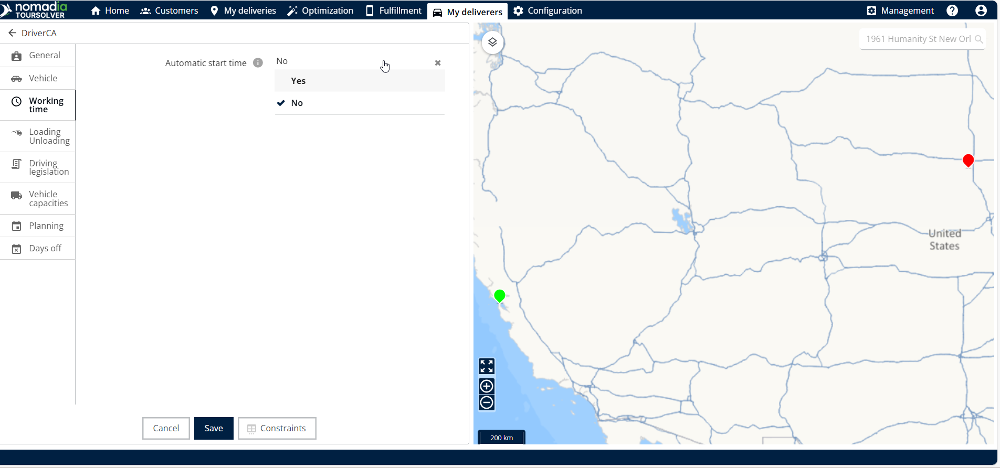
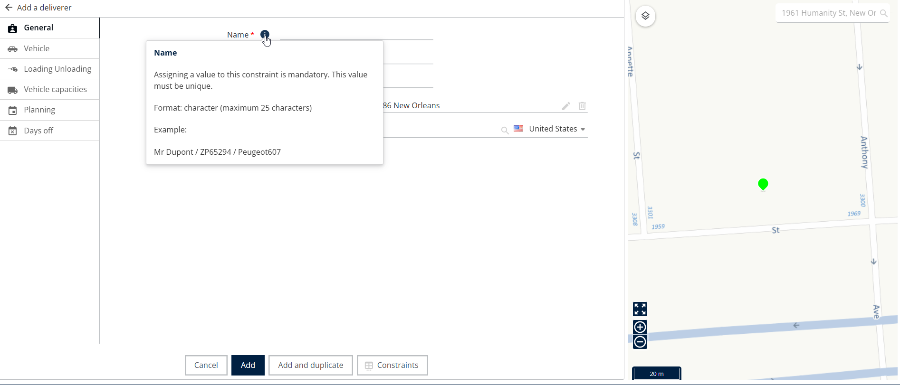

# Creazione di una risorsa

## 1. Introduzione

Benvenuto! Questa guida ti accompagnerà attraverso i semplici passaggi per definire una Risorsa come un membro del team per le consegne o un autista—all'interno di TourSolver. Il nostro obiettivo è assicurarci che tu possa configurare i membri del tuo team in modo accurato e sicuro, permettendo al sistema di gestire efficacemente l'assegnazione dei veicoli, gli orari di lavoro e i periodi di assenza.

## 2. Configurazione Iniziale

Per iniziare a definire un nuovo profilo risorsa:

1. Vai alla pagina **Risorse.**
2. Fai clic su **Aggiungi** situato nel menu **Azioni**.

<figure><figcaption></figcaption></figure>

## 3. Spiegazione delle funzionalità e vantaggi

* Creare una risorsa comporta la compilazione di diverse schede che definiscono come il tuo membro del team opera, come si sposta e quando è disponibile.
* **Dettagli Risorsa (Informazioni generali**): Qui identifichi il membro del team per nome e specifichi il suo punto di partenza, noto come luogo di partenza.
* **Scheda Veicoli**: Qui definisci la modalità principale usata dal membro del team si sposta selezionando il mezzo di trasporto.
* **Scheda Capacità Veicoli**: Questa sezione è fondamentale per definire cosa la risorsa (o il veicolo a essa assegnato) può trasportare. Puoi aggiungere capacità del veicolo per assicurare che i vincoli siano rispettati durante la pianificazione.
* **Schede Orario di Lavoro e Planning**: Queste sezioni definiscono la disponibilità del membro del team, inclusa la selezione se la funzione di ora di inizio automatica è attiva, la definizione di fasce di lavoro specifiche e la programmazione delle pause pranzo.
* **Scheda Giorni di Riposo**: Questo ti consente di programmare date specifiche in cui la risorsa non sarà disponibile

💡 Suggerimento: Se non sei sicuro di un campo o di un vincolo specifico durante l'inserimento dei dettagli, puoi passare il cursore sulle icone dei suggerimenti per una chiarificazione. Ogni suggerimento fornisce una breve spiegazione di ciò che quel vincolo controlla.

## 4. Creazione della Risorsa

Segui questi passaggi per creare e definire con successo il tuo nuovo membro del team per le consegne o autista.

1. Inserisci il **nome completo della risorsa**.
2. Inserisci il **luogo di partenza** (dove la risorsa inizia il proprio turno).

<figure><figcaption></figcaption></figure>

3. Vai alla **scheda Veicoli.**
4. Seleziona il **mezzo di trasporto** (es. auto, bici, camion).

<figure><figcaption></figcaption></figure>

5. Vai a **scheda Orario di lavoro.**
6. Seleziona se vuoi che la funzione di ora di inizio automatica sia attiva (sì o no).

<figure><figcaption></figcaption></figure>

### Impostazione delle Capacità del Veicolo

Se la tua risorsa trasporta merci, devi definire i suoi limiti di capacità:

1. Vai a **scheda Capacità Veicoli**.
2. Clicca sul simbolo più **(+)** situato nell'angolo inferiore.
3. Aggiungi le capacità del veicolo necessarie nei campi disponibili.

<figure><figcaption></figcaption></figure>

**Per Eliminare uno Slot di Capacità:** Se hai bisogno di rimuovere una voce di capacità, clicca sull'icona di eliminazione situata sul lato destro.

### Gestire gli Orari di Lavoro (Planning)

La scheda Planning ti permette di definire le fasce orarie di lavoro e le pause specifiche per la risorsa.

#### Per Aggiungere/Modificare le Fasce di Lavoro:

1. Vai alla **scheda Planning**.
2. Fai clic su **fascia di lavoro**.
3. Clicca su **modifica fascia** .
4. Aggiungi gli orari di lavoro specifici e clicca **modifica**.

<figure><figcaption></figcaption></figure>

#### Per Gestire le Pause Pranzo:

1. Per modificare la fascia di lavoro esistente relativa alla pausa pranzo, clicca modifica **pausa pranzo**.
2. Aggiungi l'**orario della pausa pranzo.**
3. Fai clic su **modifica** per salvare le modifiche alla fascia di lavoro della pausa pranzo.
4. Per eliminare una fascia di pausa pranzo, clicca **elimina pausa pranzo**.

<figure><figcaption></figcaption></figure>

### Aggiungere Giorni di Riposo

Usa la scheda Giorni per pianificare i periodi di assenza programmati:

1. Vai alla scheda **Giorni di Riposo**.
2. Clicca l'icona più **(+)** sul lato destro per aggiungere una nuova voce.
3. Aggiungi gli orari richiesti (dal/al) in cui la risorsa sarà assente.
4. Clicca sull'icona **aggiungi** per salvare la voce.

⚠ **Avvertenza**: Quando imposti i giorni di riposo, assicurati che la "Data a" (la data di fine) sia maggiore (più recente) della "Data da" (la data di inizio).

<figure><figcaption></figcaption></figure>

### Finalizzare la Creazione della Risorsa

1. Una volta che hai compilato tutti i dettagli necessari nelle varie schede. Clicca su **Aggiungi**.
2. La risorsa sarà creata con successo.

<figure><figcaption></figcaption></figure>

## 5. Consigli di Produttività

Questi suggerimenti ti aiuteranno a gestire rapidamente ed efficacemente orari e vincoli:

* **Comprendere i Vincoli**: Se non sei sicuro di cosa controlli una specifica impostazione, utilizza sempre le icone dei suggerimenti passando il cursore su di esse per una rapida spiegazione.

<figure><figcaption></figcaption></figure>

* **Duplicare Rapidamente le Fasce di Lavoro**: Se una risorsa ha più fasce di lavoro identiche, puoi risparmiare tempo cliccando l'opzione duplica fascia di lavoro e poi cliccando duplica per aggiungere rapidamente una copia.

<figure><figcaption></figcaption></figure>

**Gestione della capacità**: Ricorda che puoi sempre eliminare capacità del veicolo indesiderate cliccando l'icona di eliminazione sul lato destro della voce.
