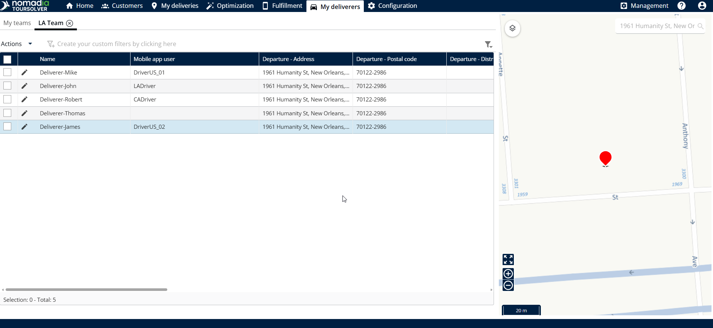
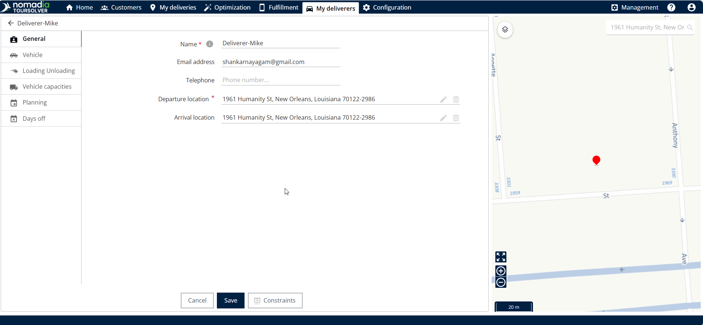
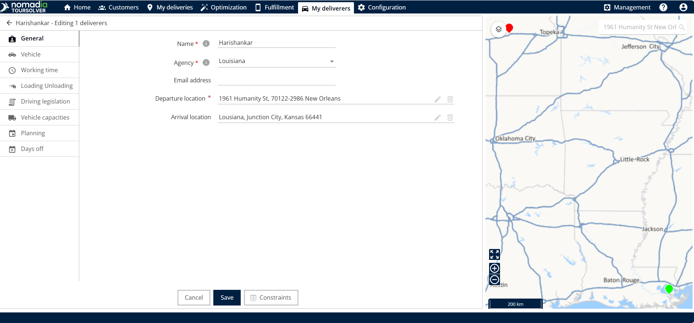
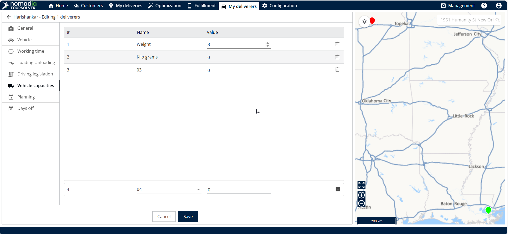
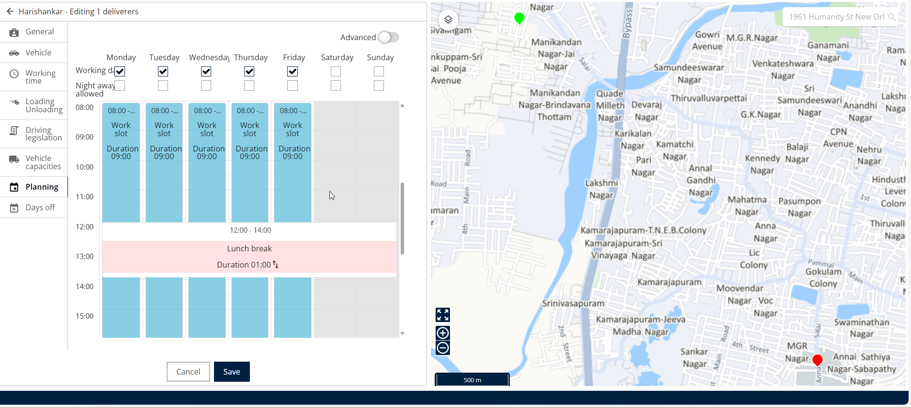
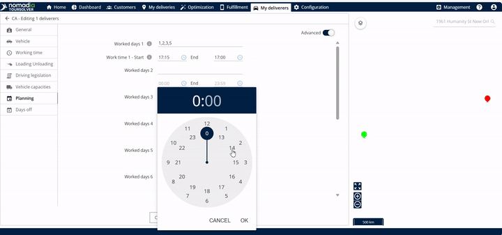
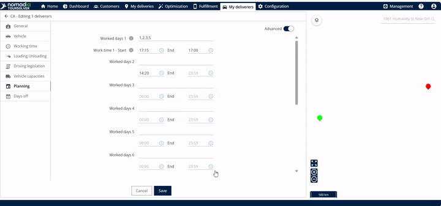

# Modifica di una risorsa e vincoli associati

## 1. Introduzione

Benvenuto alla tua guida per gestire e aggiornare in modo efficiente le risorse di consegna/visita e le loro principali restrizioni, o “vincoli”. Sapere come modificare una risorsa—che si tratti di adeguare la disponibilità di un team o di cambiare la capacità del veicolo di un individuo—è essenziale per operazioni fluide. In questa guida imparerai esattamente come modificare rapidamente e con successo programmazioni, località e capacità

## 2. Configurazione Iniziale

Puoi iniziare a modificare risorse e vincoli direttamente dalla homepage del sistema.

#### Accedi a I miei autisti/le mie risorse

<figure><figcaption></figcaption></figure>

1. **Scegli il metodo di modifica:** Hai due modi principali per modificare una risorsa: a livello di team (che interessa un gruppo) o individualmente.
2. Clicca sull'icona **modifica** (matita) accanto al nome

<figure><figcaption></figcaption></figure>

3. Puoi iniziare a modificare i vincoli associati.

<figure><figcaption></figcaption></figure>

## 3. Spiegazione delle funzionalità e vantaggi

I vincoli sono le regole che governano quando, dove e come opera una risorsa. Ecco i vincoli comunemente usati spiegati:

* Località di partenza e di arrivo: Questa impostazione definisce il punto di inizio e fine della giornata della risorsa. Modificare queste località è fondamentale se l'indirizzo tipico di inizio o fine cambia (ad es., se lavora da un deposito diverso o torna a casa).
* Capacità del veicolo: Questo ti permette di impostare limiti sulla capacità del veicolo, tipicamente misurata per peso. Ciò garantisce che il tuo veicolo di consegna non sia mai sovraccarico, contribuendo a percorsi sicuri e conformi. Puoi impostare il valore del peso in chilogrammi (kg) o grammi (g).
* Planning (Fasce orarie di lavoro): Questo determina la disponibilità lavorativa della risorsa. Puoi gestire gli orari di inizio e fine esatti e specificare in quali giorni della settimana è disponibile.

**Suggerimento**: Per saperne di più su altri vincoli, consulta la documentazione sui vincoli.

## 4. Modifica delle località di partenza e di arrivo

Una volta che hai accesso alla schermata di modifica dei vincoli (usando l'icona a matita), segui i passaggi sottostanti per aggiornare i dettagli specifici della risorsa.

Se il punto di inizio o di fine di una risorsa cambia, puoi aggiornarlo qui.

1. **Individua l'indirizzo**: Per modificare in generale la località di partenza o di arrivo, cerca la sezione pertinente (Località di partenza o Località di arrivo).
2. **Aggiorna l'indirizzo**: Modifica l'indirizzo di partenza e di arrivo secondo necessità.

<figure><figcaption></figcaption></figure>

Dopo la modifica, vedrai le differenze sulla mappa. Il colore usato sarà diverso per le località di partenza e di arrivo (ad es., verde o rosso).

### Aggiornamento delle capacità del veicolo (Peso)

1. Puoi gestire il peso massimo che il veicolo di una risorsa può trasportare.
2. **Modifica valore**: Modifica il valore del peso. Puoi inserire questo valore in chilogrammi o grammi.

<figure><figcaption></figcaption></figure>

La sezione Planning controlla quando la tua risorsa è disponibile per lavorare. Ci sono due metodi per modificare gli orari di lavoro: Visualizzazione Semplice e Visualizzazione Avanzata.

#### Visualizzazione Semplice (Stesso orario ogni giorno)

Usa la Visualizzazione Semplice se l'orario di lavoro è lo stesso in tutti i giorni lavorativi.

1. **Accedi al Planning**: Clicca su Planning.
2. **Accedi alla Fascia oraria**: Nella Visualizzazione Semplice, clicca sulla fascia oraria.
3. **Modifica la fascia di lavoro**: Clicca su Modifica Fascia di lavoro.
4. **Imposta orari di inizio e fine**: Modifica l'orario di inizio e l'orario di fine.
5. **Conferma**: Clicca su **pulsante Modifica**.

<figure><figcaption></figcaption></figure>

#### Visualizzazione Avanzata (Orari diversi per giorni diversi)

Usa la Visualizzazione Avanzata se hai bisogno di impostare orari di inizio e fine unici per specifici giorni di lavoro.

1. **Accedi al Planning**: Clicca su Planning.
2. **Seleziona i giorni lavorativi**: Nella Visualizzazione Avanzata, puoi modificare i “giorni lavorativi” (ad es., giorno lavorativo 1, giorno lavorativo 2, etc.). Puoi specificare un intervallo, come da 1 a 5, che rappresenta da lunedì a venerdì. Puoi anche inserire giorni specifici come 1, 2, 3, 4, 5.
3. **Effettua la configurazione**: Verrà visualizzata l'immagine dell'orologio, permettendoti di effettuare la configurazione degli orari.
4. **Conferma gli orari**: Dopo aver effettuato la modifica all'interno dell'orologio, clicca su OK.

<figure><figcaption></figcaption></figure>

#### Salvataggio di tutte le modifiche

Una volta completate tutte le modifiche necessarie in **Partenza, Arrivo, Capacità e Planning:**

* Le modifiche saranno visualizzate correttamente

<figure><figcaption></figcaption></figure>

## 5. Consigli di Produttività

Per aiutarti a ottenere il massimo dalla gestione delle risorse:

* **Modifica efficiente del tempo**: Usa l'icona dell'orologio accanto all'orario per richiamare rapidamente l'immagine dell'orologio e fare configurazioni precise dell'orario.
* **Eliminazione rapida**: Se devi rimuovere uno specifico valore di capacità del veicolo, cerca immediatamente sul lato destro della voce di peso l'icona di eliminazione.
