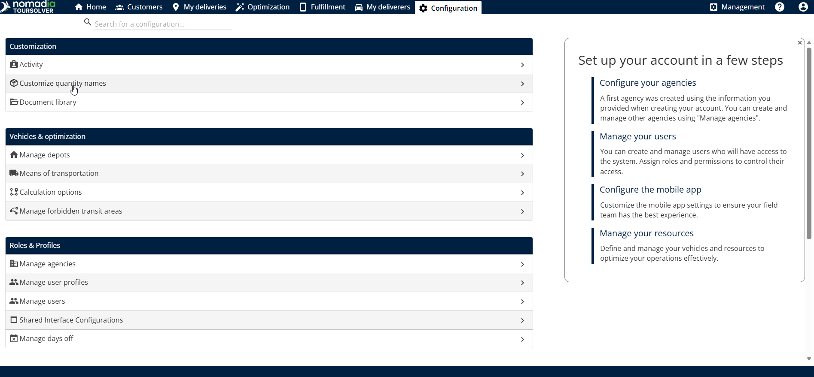
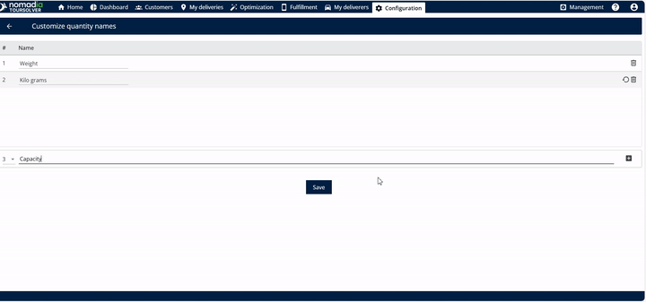
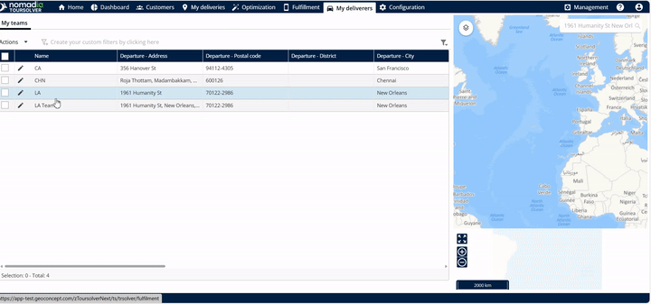
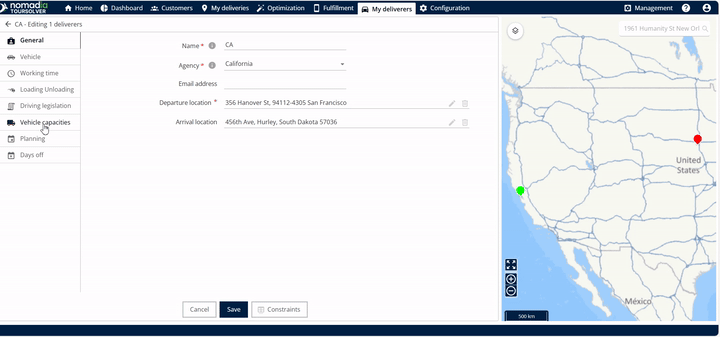
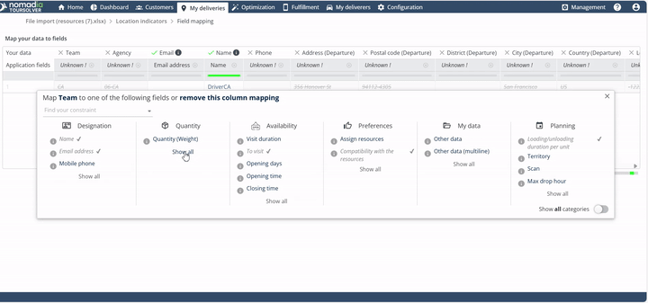

# Rinominare una quantità di un veicolo

## 1. Introduzione

Rinominare una quantità del veicolo ti aiuta a personalizzare la terminologia del sistema. Modificando questi nomi, garantisci chiarezza e coerenza quando visualizzi le capacità dei veicoli e importi nuove informazioni di consegna. Stai imparando come rinominare con successo la quantità di un veicolo.

## 2. Configurazione iniziale

Vai a _**Configurazione → Risorse → Veicoli**_**&#x20;e rinomina il campo Quantità** per impostare l'etichetta che preferisci

## 3. Spiegazioni delle funzionalità e vantaggi

La possibilità di personalizzare i nomi delle quantità offre un vantaggio significativo mostrando i nomi definiti dall'utente in due aree chiave:

* **Visualizzazione della capacità del veicolo**: Dopo la rinomina, i nuovi nomi sono visibili quando controlli i dettagli della capacità di un veicolo. Questo ti permette di verificare rapidamente quali limitazioni di capacità sono assegnate alla tua flotta.
* **Schermata di import delle consegne**: I nuovi nomi vengono visualizzati quando importi nuove consegne. In particolare, appaiono quando selezioni **Mostra tutto** nella sezione quantità durante il processo di import, garantendo un corretto mapping dei dati.

## 4. Rinomina di una quantità del veicolo

Segui questi semplici passaggi per aggiornare i nomi delle quantità nel tuo sistema:

1. **Accedi alla Configurazione**
2. **Vai a Personalizza i nomi delle quantità**

<figure><figcaption></figcaption></figure>

3. **Rinomina la Quantità**
4. **Salva le modifiche**

<figure><figcaption></figcaption></figure>

## 5. Verifica dei nuovi nomi nelle capacità dei veicoli

1. **Vai a I miei autisti /** **le mie risorse**
2. **Modifica un veicolo**

<figure><figcaption></figcaption></figure>

3. **Visualizza le capacità del veicolo**
4. **Conferma il nome**

<figure><figcaption></figcaption></figure>

## 6. Verifica dei nuovi nomi durante l'import delle consegne

Le quantità rinominate sono visibili anche quando importi le consegne:

1. **Vai a Le mie consegne**
2. **Avvia import**
3. **Gestisci campi indirizzo sconosciuti**
4. **Mostra tutte le quantità**
5. **Conferma il nuovo nome**

<figure><figcaption></figcaption></figure>

## 7. Suggerimenti per la produttività

* **Suggerimento**: La verifica immediata è fondamentale. Dopo aver salvato la quantità rinominata, prenditi un momento per verificarne immediatamente la modifica sia nelle capacità del veicolo sia controllando un'import di consegna in sospeso. Questo assicura che le modifiche si siano propagate correttamente nel sistema.
* **Suggerimento**: Mantienilo semplice, usa nomi chiari e concisi che siano facili da capire per tutti i membri del tuo team. Poiché il nuovo nome verrà visualizzato in più aree, scegliere un linguaggio accessibile evita confusione.
* **Avvertenza**: Assicurati di aver aggiornato tutti i campi necessari prima di fare clic su Salva per evitare di dover tornare più volte al menu di personalizzazione.
